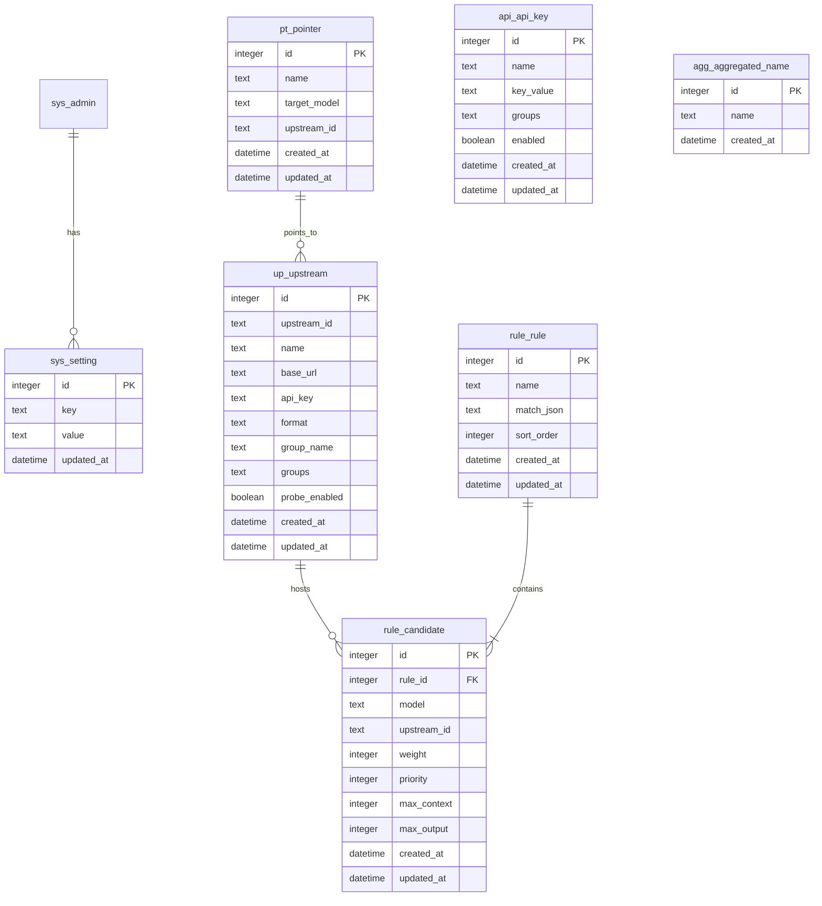

# Smart Router 数据库设计

> 创建时间：2026-08-09
> 状态：待确认
> 关联流程：fullstack-dev-flow stage-2
> 关联需求：[docs/需求规格.md](需求规格.md)
> 数据库：SQLite（重构 v5 从 YAML 迁移）

---

## 一、设计原则

- 数据库用 SQLite（单文件，零运维，适合单机部署）
- 主键统一命名 `id`，自增
- 时间字段统一 `created_at` / `updated_at`
- 表名前缀 `api_`（客户端密钥）、`up_`（上游）、`rule_`（路由规则）、`pt_`（指针）、`agg_`（聚合名）、`sys_`（系统）
- 配置类表（rules/upstreams 等）字段名与 v4 config.yaml 保持一致，便于迁移
- 软删除不启用（配置类数据删除后即物理删除，无历史追溯需求）
- 规则与候选模型采用父子表（一条规则多个候选模型）

## 二、ER 图

## 三、表清单

### 3.1 api_api_key (客户端密钥表)

**说明**: 客户端访问路由代理的入场券，白名单 + 分组权限

| 字段 | 类型 | 约束 | 默认 | 注释 |
|------|------|------|------|------|
| id | integer | PK, auto_increment | - | 主键 |
| name | text | not null | - | 密钥名称（如"扣子平台"） |
| key_value | text | not null, unique | - | 密钥值（如 sk-your-key） |
| groups | text | not null | `["free"]` | 可访问分组列表（JSON 数组字符串） |
| enabled | boolean | not null | true | 是否启用 |
| created_at | datetime | not null | CURRENT_TIMESTAMP | 创建时间 |
| updated_at | datetime | not null | CURRENT_TIMESTAMP | 更新时间 |

**索引**:
- uk_key_value (key_value) - 鉴权时按密钥值精确查询

### 3.2 up_upstream (上游源表)

**说明**: 模型提供商接入点

| 字段 | 类型 | 约束 | 默认 | 注释 |
|------|------|------|------|------|
| id | integer | PK, auto_increment | - | 主键 |
| upstream_id | text | not null, unique | - | 上游源 ID（如 newapi） |
| name | text | not null | - | 显示名称（如 NewAPI 中转站） |
| base_url | text | not null | - | 上游源地址 |
| api_key | text | not null | - | 上游源 API Key（单 Key 快捷写法，Key 池启用后作兜底） |
| format | text | not null | 'openai' | 源级协议格式: openai / anthropic / responses（模型级可用 models 条目 protocol 覆盖，CH-011/014） |
| group_name | text | not null | 'free' | 所属分组（CH-016 起逻辑废弃，保留作 groups 首元素冗余） |
| groups | text | not null | '[]' | 归属分组数组 JSON（CH-016 多分组；空则回退 [group_name]；与 Key 分组取交集判定权限） |
| probe_enabled | boolean | not null | true | 是否参与延迟探测 |
| enabled | integer | not null | 1 | 是否启用（CH-001，0/1） |
| models | text | not null | '[]' | 已配置模型列表 JSON（CH-005；CH-011 起为对象条目 [{name, protocol?}]，存量字符串数组读取时自动归一化） |
| smart_retry | integer | not null | 0 | 智能重试开关（CH-012，0/1，默认关） |
| created_at | datetime | not null | CURRENT_TIMESTAMP | 创建时间 |
| updated_at | datetime | not null | CURRENT_TIMESTAMP | 更新时间 |

**索引**:
- uk_upstream_id (upstream_id) - 路由时按 ID 查询

> 注：一个上游源可配置多个 Key（Key 池），存于 `up_upstream_key`；`api_key` 为存量单 Key 字段，迁移为 Key 池第一条。

### 3.2.1 up_upstream_key (上游源 Key 池表)

**说明**: 一个上游源挂多个 API Key，请求轮询选择，单个 Key 失败/限流自动换下一个

| 字段 | 类型 | 约束 | 默认 | 注释 |
|------|------|------|------|------|
| id | integer | PK, auto_increment | - | 主键 |
| upstream_id | text | not null | - | 所属上游源 ID（逻辑外键 → up_upstream） |
| api_key | text | not null | - | 上游源 API Key |
| enabled | integer | not null | 1 | 是否启用（0/1） |
| created_at | datetime | not null | CURRENT_TIMESTAMP | 创建时间 |
| updated_at | datetime | not null | CURRENT_TIMESTAMP | 更新时间 |

**索引**:
- idx_upstream_key_upstream (upstream_id) - 按上游查询

> 建表语句见增量 SQL：`sql/increment/02_增量_20260809_上游Key池.sql`（含存量 `up_upstream.api_key` 迁移）

### 3.8 可配置分组（存于 sys_setting，CH-008）

**说明**: 分组不建表，存 `sys_setting` 键 `groups`，JSON 数组 `[{name, description}]`（默认 free/premium）。上游源按 `up_upstream.groups` JSON 数组归属**多个分组**（CH-016）；API Key 按 `api_api_key.groups` JSON 数组拥有多个分组；**两侧分组集合有交集即放行**（无交集 403）。被上游源或 API Key 引用的分组不可删除（接口层校验）。`*` 为通配分组（Key 配置 `["*"]` 可访问全部上游）。

### 3.9 sys_setting 迭代新增键

| 键 | 内容 | 来源 |
|----|------|------|
| groups | 可配置分组 `[{name, description}]` | CH-008 |
| smart_retry | 智能重试全局参数 `{extra_attempts, backoff_ms, jitter}` | CH-012 |
| aggregation_order | 聚合列表人工拖拽顺序 `["聚合名", ...]`（空数组 = 按 `kind+name` 默认顺序；未列入的排在末尾） | CH-028 |
| log_routing | 是否记录路由明细日志（bool，默认 true） | v5 基线（`02_init_data.sql`） |
| usage_retention_days | 用量明细保留天数（默认 30，启动时按此清理） | CH-019 |

> 另有基线键 `admin` / `latency_probe` / `retry` / `failover` / `listen_port` / `default_upstream` / `log_level`，见 3.7 表说明。
> `auto_same_name_aggregate` 历史上有定义（`core/config_upstream.py` 的 `auto_same_name_enabled()`），但**无任何调用点、设置页也无开关**，属未生效的预留键，未列入上表。

### 3.3 rule_rule (路由规则表)

**说明**: 路由规则，含匹配条件和排序

| 字段 | 类型 | 约束 | 默认 | 注释 |
|------|------|------|------|------|
| id | integer | PK, auto_increment | - | 主键 |
| name | text | not null | - | 规则名称（如"视觉理解"） |
| match_json | text | not null | '{}' | 匹配条件 JSON（has_image/has_tools/default/content_keywords） |
| sort_order | integer | not null | 0 | 匹配顺序（小的优先） |
| created_at | datetime | not null | CURRENT_TIMESTAMP | 创建时间 |
| updated_at | datetime | not null | CURRENT_TIMESTAMP | 更新时间 |

### 3.4 rule_candidate (候选模型表)

**说明**: 路由规则下的候选模型项

| 字段 | 类型 | 约束 | 默认 | 注释 |
|------|------|------|------|------|
| id | integer | PK, auto_increment | - | 主键 |
| rule_id | integer | not null, FK->rule_rule.id | - | 所属规则 ID |
| model | text | not null | - | 模型名（如 mistralai/mistral-large-...） |
| upstream_id | text | not null | - | 所属上游源 ID |
| weight | integer | not null | 1 | 路由权重 |
| priority | integer | not null | 1 | 优先级（小的优先） |
| max_context | integer | null | null | 最大上下文（token） |
| max_output | integer | null | null | 最大输出（token） |
| created_at | datetime | not null | CURRENT_TIMESTAMP | 创建时间 |
| updated_at | datetime | not null | CURRENT_TIMESTAMP | 更新时间 |

**索引**:
- idx_rule_id (rule_id) - 按规则查候选

### 3.5 pt_pointer (模型别名表)

**说明**: 模型别名指针，别名 → 固定模型，不走路由

| 字段 | 类型 | 约束 | 默认 | 注释 |
|------|------|------|------|------|
| id | integer | PK, auto_increment | - | 主键 |
| name | text | not null, unique | - | 别名名称（如 my-model） |
| target_model | text | not null | - | 目标模型名 |
| upstream_id | text | not null | - | 目标上游源 ID |
| created_at | datetime | not null | CURRENT_TIMESTAMP | 创建时间 |
| updated_at | datetime | not null | CURRENT_TIMESTAMP | 更新时间 |

**索引**:
- uk_name (name) - 按别名名查询

### 3.6 agg_aggregated_name (聚合模型名表)

**说明**: 客户端可用的统一模型名列表

| 字段 | 类型 | 约束 | 默认 | 注释 |
|------|------|------|------|------|
| id | integer | PK, auto_increment | - | 主键 |
| name | text | not null, unique | - | 聚合模型名（如 smart-latest） |
| created_at | datetime | not null | CURRENT_TIMESTAMP | 创建时间 |

### 3.10 agg_model_group (模型聚合组配置，CH-019 / CH-020)

**说明**: 模型跨源聚合的人工覆盖配置。**无行 = 自动发现同名模型**；有行 = 以配置为准（支持异名成员）。

| 字段 | 类型 | 约束 | 默认 | 注释 |
|------|------|------|------|------|
| id | integer | PK, auto_increment | - | 主键 |
| model | text | not null, unique | - | **聚合名**（客户端请求时使用的名字，如 deepseek-v4-1-flash） |
| upstreams | text | not null | '[]' | JSON 数组 `[{"upstream":"xxx","model":"该源真实模型名","weight":1}]`，**顺序即候选优先级**；`model` 为空表示与聚合名同名 |
| enabled | integer | not null | 1 | 0 = 关闭聚合，退化为取第一个可用成员直连 |
| created_at | timestamp | not null | CURRENT_TIMESTAMP | 创建时间 |
| updated_at | timestamp | not null | CURRENT_TIMESTAMP | 更新时间 |

**索引**: idx_model_group_model (model)

> CH-020 扩展：`upstreams` 成员新增 `model` 字段，使不同源里的**异名模型**（如 `buddy/deepseek-v4.1-flash` 与 `loomy/DeepSeek-V4.1-Flash`）可归入同一聚合名。无 DDL，仅 JSON 结构扩展，存量数据零迁移。

### 3.11 log_usage (用量统计表，CH-019)

**说明**: 每次客户端请求一行，三层统计（全局/模型级/Key 级）的数据源；后台线程每 5s 批量落库，按 `usage_retention_days`（默认 30 天）定期清理。

| 字段 | 类型 | 约束 | 默认 | 注释 |
|------|------|------|------|------|
| id | integer | PK, auto_increment | - | 主键 |
| ts | real | not null | - | 请求完成时间 epoch |
| api_key_id | integer | - | - | 客户端 Key id（未认证失败不记） |
| api_key_name | text | - | - | 客户端 Key 名称快照 |
| upstream_id | text | - | - | 实际命中的上游源（重试成功取成功者；全失败取最后尝试者） |
| upstream_name | text | - | - | 上游源名称快照 |
| model | text | - | - | 客户端请求的模型名 |
| upstream_model | text | - | - | **实际命中的上游真实模型名**（CH-021）；异名聚合时与 `model` 不同，为空时统计回退用 `model` |
| protocol | text | - | 'chat' | 入站协议：chat / anthropic / responses |
| stream | integer | - | 0 | 是否流式 |
| status | text | - | - | success / error |
| http_status | integer | - | - | HTTP 状态码 |
| prompt_tokens | integer | - | 0 | 输入 tokens |
| completion_tokens | integer | - | 0 | 输出 tokens |
| total_tokens | integer | - | 0 | 总 tokens |
| estimated | integer | - | 0 | 1 = 上游未返回 usage，按字符估算 |
| duration_ms | integer | - | - | 总耗时 |
| first_token_ms | integer | - | - | 流式首包耗时 |
| error_msg | text | - | - | 失败摘要（截断 500 字） |
| created_at | text | - | datetime('now','localtime') | 落库时间（本地时区） |

**索引**: idx_usage_ts (ts) / idx_usage_key_ts (api_key_id, ts) / idx_usage_model_ts (model, ts) / idx_usage_unit (upstream_id, upstream_model, ts)

### 3.12 agg_probe_config (聚合组探测配置，CH-021)

**说明**: 每个聚合组独立的探测策略。**与 `agg_model_group` 解耦**——自动发现的聚合组也能单独配探测，且不会因此变成"已手动配置"。字段留空（NULL）表示跟随全局 `sys_setting.latency_probe`。

| 字段 | 类型 | 约束 | 默认 | 注释 |
|------|------|------|------|------|
| model | text | PK | - | 聚合名（组标识） |
| enabled | integer | not null | 0 | 该组是否启用定时探测 |
| interval_seconds | integer | - | NULL | 探测间隔；NULL = 跟随全局 |
| slow_threshold_seconds | real | - | NULL | 慢阈值；超过则排到后面；NULL = 跟随全局 |
| sort_mode | text | not null | 'stable' | `stable`（稳定优先）/ `latency`（速度优先） |
| schedule | text | not null | '{}' | 探测时段 JSON：`{"mode":"always"}` 或 `{"mode":"window","days":[1..7],"windows":[{"start":"08:00","end":"23:00"}]}` |
| updated_at | timestamp | not null | CURRENT_TIMESTAMP | 更新时间 |

> `days` 空数组 = 每天；`windows` 空数组 = 全天；`end < start` 表示跨夜。
> UI 用 `0` 表示"跟随全局"，后端归一化为 `NULL`。
> **CH-023 起**：本表降级为兼容兜底（自动发现的聚合组仍写这里），聚合自身的探测配置已迁移到 `agg_unified`；读取优先级为模板 → `agg_unified` → 本表 → 全局。

### 3.13 agg_probe_template (探测模板，CH-023)

**说明**: 一套可复用的探测节奏。多个聚合引用同一模板即共用同一节奏，**模板值不可被聚合覆盖**；改模板对所有引用方立即生效。

| 字段 | 类型 | 约束 | 默认 | 注释 |
|------|------|------|------|------|
| id | integer | PK, auto_increment | - | 主键 |
| name | text | not null, unique | - | 模板名（如「高频-交易时段」） |
| interval_seconds | integer | not null | - | 探测间隔（秒，≥10） |
| slow_threshold_seconds | real | - | NULL | 慢阈值；NULL = 跟随全局 |
| sort_mode | text | not null | 'stable' | `stable` / `latency`（仅 static 聚合生效） |
| schedule | text | not null | '{}' | 探测时段 JSON，结构同 3.12 |
| remark | text | - | - | 备注 |
| created_at | timestamp | not null | CURRENT_TIMESTAMP | 创建时间 |
| updated_at | timestamp | not null | CURRENT_TIMESTAMP | 更新时间 |

### 3.14 agg_unified (统一聚合实体，CH-023)

**说明**: 一行 = 一个聚合名，用 `kind` 区分两类语义，替代原 `agg_model_group` + `agg_aggregated_name` 两套表。旧表保留做回滚兜底，启动时幂等迁移。

| 字段 | 类型 | 约束 | 默认 | 注释 |
|------|------|------|------|------|
| name | text | PK | - | 聚合名（客户端请求用） |
| kind | text | not null | - | `static`（固定成员）/ `rule`（候选由路由规则运行时匹配） |
| members | text | not null | '[]' | 仅 static：JSON `[{"upstream","model","weight"}]`，顺序即优先级 |
| rule_bindings | text | - | NULL | 仅 rule：JSON 绑定（CH-024），见下 |
| enabled | integer | not null | 1 | 聚合是否启用 |
| probe_enabled | integer | not null | 0 | 是否对该聚合涉及的探测单元定时探测 |
| template_id | integer | - | NULL | 探测模板；非空时模板值优先，自配字段不生效 |
| sort_mode | text | not null | 'stable' | `stable` / `latency`（仅 static 生效） |
| interval_seconds | integer | - | NULL | 自配间隔；NULL = 跟随全局 |
| slow_threshold_seconds | real | - | NULL | 自配慢阈值；NULL = 跟随全局 |
| schedule | text | not null | '{}' | 自配探测时段，结构同 3.12 |
| remark | text | - | - | 备注 |
| created_at | timestamp | not null | CURRENT_TIMESTAMP | 创建时间 |
| updated_at | timestamp | not null | CURRENT_TIMESTAMP | 更新时间 |

**索引**: idx_agg_unified_kind (kind) / idx_agg_unified_template (template_id)

> **生效参数优先级**：模板（`template_id` 非空）→ 聚合自配 → 全局 `sys_setting.latency_probe` → 内置默认。
> **删除模板**：引用方 `template_id` 置空，回退到自配 → 全局，聚合本身不删。
> **rule 聚合**：`members` 恒为空；探测对象 = 绑定的路由规则候选的并集（无绑定则为全部规则候选并集）。
> **`rule_bindings`（CH-024）**：仅 `kind='rule'` 有意义的 JSON 数组，决定该聚合实际使用哪些规则、每条规则用哪些候选。

| 值 | 语义 |
|---|---|
| `NULL` / `[]` | **全跟随**：使用所有规则、每条规则的全部候选（兼容 CH-023 老数据） |
| `[{"rule":"默认对话","candidates":null}]` | 只使用列出的规则，规则内全部候选都跟随（规则以后加模型会自动纳入） |
| `[{"rule":"视觉理解","candidates":[{"upstream":"buddy","model":"gemini-2.5-pro"}]}]` | 显式候选子集；规则里新增的模型不会自动纳入 |

> 候选用 `{upstream, model}` 对象而非 `"upstream:model"` 字符串（模型名可能含冒号）。
> 规则被删除/改名时由 `prune_rule_bindings()` 自动清理，清理后为空则回退 `NULL`（全跟随）；候选被移出规则不报错，运行时静默跳过并由接口返回 `stale` 标记。

### 3.7 sys_setting (系统参数表)

**说明**: key-value 系统参数（延迟探测/重试/故障转移/管理账号/端口/日志/同名聚合开关/用量保留天数）

| 字段 | 类型 | 约束 | 默认 | 注释 |
|------|------|------|------|------|
| id | integer | PK, auto_increment | - | 主键 |
| key | text | not null, unique | - | 参数键（如 latency_probe/retry/failover/admin/listen_port/default_upstream/log_level） |
| value | text | not null | - | 参数值（JSON 字符串） |
| updated_at | datetime | not null | CURRENT_TIMESTAMP | 更新时间 |

**索引**:
- uk_key (key) - 按 key 查询

> 注：`sys_setting` 中 admin 键存储 {username, password, session_hours}；latency_probe/retry/failover 存储对应配置 dict。

## 四、表关系说明

| 主表 | 关系 | 从表 | 关系类型 | 说明 |
|------|------|------|---------|------|
| rule_rule | 1:N | rule_candidate | 一对多 | 一条规则多个候选模型 |
| up_upstream | 1:N | rule_candidate | 一对多（逻辑） | 一个上游源被多条候选引用 |
| up_upstream | 1:N | pt_pointer | 一对多（逻辑） | 一个上游源被多个别名指向 |
| up_upstream | 1:N | up_upstream_key | 一对多（逻辑） | 一个上游源挂多个 API Key（Key 池） |

> rule_candidate.upstream_id、pt_pointer.upstream_id 为逻辑外键（存 ID 字符串），因为配置类数据删除后无需级联约束。

## 五、初始数据需求

需要初始数据（对应 v4 config.yaml 种子）：
- sys_setting: admin（用户名/密码/会话时长）、latency_probe、retry、failover、listen_port、default_upstream、log_level
- api_api_key: 默认 Key / 扣子平台 / 我的专属 Key（3 条）
- up_upstream: newapi / xiaomi（2 条）
- rule_rule + rule_candidate: 视觉理解 / 工具调用 / 默认对话（3 条规则 + 候选）
- pt_pointer: my-model / code / fast（3 条）
- agg_aggregated_name: smart-latest / smart-chat / auto-chat（3 条）

初始数据脚本：`sql/02_init_data.sql` 或由 `seed.py` 初始化（阶段 3 执行）。

## 六、SQL 文件说明

| 文件 | 说明 | 顺序 |
|------|------|------|
| sql/01_建表.sql | 全部业务表建表（SQLite 基线，**不含**下方增量补的列） | 1 |
| sql/02_init_data.sql | 初始数据（种子配置） | 2 |
| sql/increment/01_增量_20260809_上游源禁用.sql | up_upstream 加 enabled 列（CH-001） | 3 |
| sql/increment/02_增量_20260809_上游Key池.sql | 新增 up_upstream_key 表 + 存量 api_key 迁移（CH-003） | 4 |
| sql/increment/03_增量_20260809_上游模型列表.sql | up_upstream 加 models 列（CH-005） | 5 |
| sql/increment/04_增量_20260810_智能重试开关.sql | up_upstream 加 smart_retry 列（CH-012） | 6 |
| sql/increment/05_增量_20260811_上游多分组.sql | up_upstream 加 groups 列（CH-016） | 7 |
| sql/06_用量统计与自动聚合.sql | 新建 log_usage + agg_model_group + sys_setting 两键（CH-019，幂等） | 8 |
| sql/increment/06_增量_20261017_聚合探测配置.sql | 新建 agg_probe_config + log_usage 加 upstream_model 列（CH-021，幂等；启动时也会自动补） | 9 |
| sql/increment/07_增量_20261017_聚合统一与探测模板.sql | 新建 agg_unified + agg_probe_template，并把旧聚合表数据幂等迁移进来（CH-023，启动时也会自动执行） | 10 |
| sql/increment/08_增量_20261017_聚合规则绑定.sql | agg_unified 加 rule_bindings 列 + idx_agg_unified_kind 索引（CH-024，启动时也会自动执行） | 11 |

> **CH-029**：`backend/seed.py` 已按上表顺序一次性执行全部 11 个脚本，全新环境跑一次 `seed.py` 即可得到完整结构（此前只跑 01/02，会缺 `up_upstream_key` 表与 4 个列，导致启动崩溃）。
> **已在运行的环境无需重复执行**：启动时 `startup()` 会自动幂等补齐 06/07/08 与 `log_usage.upstream_model`。

## 七、变更记录

| 日期 | 变更内容 | 变更人 |
|------|---------|--------|
| 2026-08-09 | 初始创建（v5 从 YAML 迁移到 SQLite） | AI+用户 |
| 2026-08-09 | 新增 up_upstream_key 表（上游源 Key 池，CH-003） | AI+用户 |
| 2026-08-10 | 攒批同步：up_upstream 补 enabled/models/smart_retry 列说明；新增 3.8 可配置分组（存 sys_setting，CH-008）与 3.9 sys_setting 迭代键；SQL 文件表补增量 03/04 | AI+用户 |
| 2026-10-16 | CH-019：新增 3.10 agg_model_group（同名聚合人工配置）、3.11 log_usage（用量统计）；up_upstream.models 条目扩展 enabled/order 字段（无 DDL）；补 SQL 06 | AI+用户 |
| 2026-10-16 | CH-020：3.10 agg_model_group 升级——`model` 语义改为"聚合名"，`upstreams` 成员新增 `model` 字段以支持异名模型聚合（无 DDL） | AI |
| 2026-10-17 | CH-021：新增 3.12 agg_probe_config（聚合组独立探测 + 时段）；3.11 log_usage 补 upstream_model 列与 idx_usage_unit 索引；补增量 SQL 06 | AI |
| 2026-10-17 | CH-023：新增 3.13 agg_probe_template（探测模板）、3.14 agg_unified（统一聚合实体 static/rule）；agg_probe_config 降级为兼容兜底；补增量 SQL 07（含幂等迁移，启动时自动执行） | AI |
| 2026-10-17 | CH-024：agg_unified 新增 `rule_bindings` 列（rule 聚合的规则/候选子集绑定）；补增量 SQL 08 | AI |
