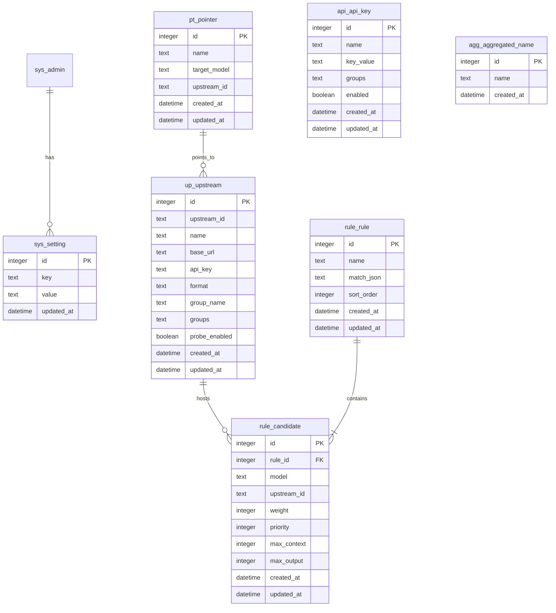

# Smart Router 数据库设计

> 创建时间：2026-08-09
> 状态：待确认
> 关联流程：fullstack-dev-flow stage-2
> 关联需求：[docs/需求规格.md](需求规格.md)
> 数据库：SQLite（重构 v5 从 YAML 迁移）

---

## 一、设计原则

- 数据库用 SQLite（单文件，零运维，适合单机部署）
- 主键统一命名 `id`，自增
- 时间字段统一 `created_at` / `updated_at`
- 表名前缀 `api_`（客户端密钥）、`up_`（上游）、`rule_`（路由规则）、`pt_`（指针）、`agg_`（聚合名）、`sys_`（系统）
- 配置类表（rules/upstreams 等）字段名与 v4 config.yaml 保持一致，便于迁移
- 软删除不启用（配置类数据删除后即物理删除，无历史追溯需求）
- 规则与候选模型采用父子表（一条规则多个候选模型）

## 二、ER 图

## 三、表清单

### 3.1 api_api_key (客户端密钥表)

**说明**: 客户端访问路由代理的入场券，白名单 + 分组权限

| 字段 | 类型 | 约束 | 默认 | 注释 |
|------|------|------|------|------|
| id | integer | PK, auto_increment | - | 主键 |
| name | text | not null | - | 密钥名称（如"扣子平台"） |
| key_value | text | not null, unique | - | 密钥值（如 sk-your-key） |
| groups | text | not null | `["free"]` | 可访问分组列表（JSON 数组字符串） |
| enabled | boolean | not null | true | 是否启用 |
| created_at | datetime | not null | CURRENT_TIMESTAMP | 创建时间 |
| updated_at | datetime | not null | CURRENT_TIMESTAMP | 更新时间 |

**索引**:
- uk_key_value (key_value) - 鉴权时按密钥值精确查询

### 3.2 up_upstream (上游源表)

**说明**: 模型提供商接入点

| 字段 | 类型 | 约束 | 默认 | 注释 |
|------|------|------|------|------|
| id | integer | PK, auto_increment | - | 主键 |
| upstream_id | text | not null, unique | - | 上游源 ID（如 newapi） |
| name | text | not null | - | 显示名称（如 NewAPI 中转站） |
| base_url | text | not null | - | 上游源地址 |
| api_key | text | not null | - | 上游源 API Key（单 Key 快捷写法，Key 池启用后作兜底） |
| format | text | not null | 'openai' | 源级协议格式: openai / anthropic / responses（模型级可用 models 条目 protocol 覆盖，CH-011/014） |
| group_name | text | not null | 'free' | 所属分组（CH-016 起逻辑废弃，保留作 groups 首元素冗余） |
| groups | text | not null | '[]' | 归属分组数组 JSON（CH-016 多分组；空则回退 [group_name]；与 Key 分组取交集判定权限） |
| probe_enabled | boolean | not null | true | 是否参与延迟探测 |
| enabled | integer | not null | 1 | 是否启用（CH-001，0/1） |
| models | text | not null | '[]' | 已配置模型列表 JSON（CH-005；CH-011 起为对象条目 [{name, protocol?}]，存量字符串数组读取时自动归一化） |
| smart_retry | integer | not null | 0 | 智能重试开关（CH-012，0/1，默认关） |
| created_at | datetime | not null | CURRENT_TIMESTAMP | 创建时间 |
| updated_at | datetime | not null | CURRENT_TIMESTAMP | 更新时间 |

**索引**:
- uk_upstream_id (upstream_id) - 路由时按 ID 查询

> 注：一个上游源可配置多个 Key（Key 池），存于 `up_upstream_key`；`api_key` 为存量单 Key 字段，迁移为 Key 池第一条。

### 3.2.1 up_upstream_key (上游源 Key 池表)

**说明**: 一个上游源挂多个 API Key，请求轮询选择，单个 Key 失败/限流自动换下一个

| 字段 | 类型 | 约束 | 默认 | 注释 |
|------|------|------|------|------|
| id | integer | PK, auto_increment | - | 主键 |
| upstream_id | text | not null | - | 所属上游源 ID（逻辑外键 → up_upstream） |
| api_key | text | not null | - | 上游源 API Key |
| enabled | integer | not null | 1 | 是否启用（0/1） |
| created_at | datetime | not null | CURRENT_TIMESTAMP | 创建时间 |
| updated_at | datetime | not null | CURRENT_TIMESTAMP | 更新时间 |

**索引**:
- idx_upstream_key_upstream (upstream_id) - 按上游查询

> 建表语句见增量 SQL：`sql/increment/02_增量_20260809_上游Key池.sql`（含存量 `up_upstream.api_key` 迁移）

### 3.8 可配置分组（存于 sys_setting，CH-008）

**说明**: 分组不建表，存 `sys_setting` 键 `groups`，JSON 数组 `[{name, description}]`（默认 free/premium）。上游源按 `up_upstream.groups` JSON 数组归属**多个分组**（CH-016）；API Key 按 `api_api_key.groups` JSON 数组拥有多个分组；**两侧分组集合有交集即放行**（无交集 403）。被上游源或 API Key 引用的分组不可删除（接口层校验）。`*` 为通配分组（Key 配置 `["*"]` 可访问全部上游）。

### 3.9 sys_setting 迭代新增键

| 键 | 内容 | 来源 |
|----|------|------|
| groups | 可配置分组 `[{name, description}]` | CH-008 |
| smart_retry | 智能重试全局参数 `{extra_attempts, backoff_ms, jitter}` | CH-012 |

### 3.3 rule_rule (路由规则表)

**说明**: 路由规则，含匹配条件和排序

| 字段 | 类型 | 约束 | 默认 | 注释 |
|------|------|------|------|------|
| id | integer | PK, auto_increment | - | 主键 |
| name | text | not null | - | 规则名称（如"视觉理解"） |
| match_json | text | not null | '{}' | 匹配条件 JSON（has_image/has_tools/default/content_keywords） |
| sort_order | integer | not null | 0 | 匹配顺序（小的优先） |
| created_at | datetime | not null | CURRENT_TIMESTAMP | 创建时间 |
| updated_at | datetime | not null | CURRENT_TIMESTAMP | 更新时间 |

### 3.4 rule_candidate (候选模型表)

**说明**: 路由规则下的候选模型项

| 字段 | 类型 | 约束 | 默认 | 注释 |
|------|------|------|------|------|
| id | integer | PK, auto_increment | - | 主键 |
| rule_id | integer | not null, FK->rule_rule.id | - | 所属规则 ID |
| model | text | not null | - | 模型名（如 mistralai/mistral-large-...） |
| upstream_id | text | not null | - | 所属上游源 ID |
| weight | integer | not null | 1 | 路由权重 |
| priority | integer | not null | 1 | 优先级（小的优先） |
| max_context | integer | null | null | 最大上下文（token） |
| max_output | integer | null | null | 最大输出（token） |
| created_at | datetime | not null | CURRENT_TIMESTAMP | 创建时间 |
| updated_at | datetime | not null | CURRENT_TIMESTAMP | 更新时间 |

**索引**:
- idx_rule_id (rule_id) - 按规则查候选

### 3.5 pt_pointer (模型别名表)

**说明**: 模型别名指针，别名 → 固定模型，不走路由

| 字段 | 类型 | 约束 | 默认 | 注释 |
|------|------|------|------|------|
| id | integer | PK, auto_increment | - | 主键 |
| name | text | not null, unique | - | 别名名称（如 my-model） |
| target_model | text | not null | - | 目标模型名 |
| upstream_id | text | not null | - | 目标上游源 ID |
| created_at | datetime | not null | CURRENT_TIMESTAMP | 创建时间 |
| updated_at | datetime | not null | CURRENT_TIMESTAMP | 更新时间 |

**索引**:
- uk_name (name) - 按别名名查询

### 3.6 agg_aggregated_name (聚合模型名表)

**说明**: 客户端可用的统一模型名列表

| 字段 | 类型 | 约束 | 默认 | 注释 |
|------|------|------|------|------|
| id | integer | PK, auto_increment | - | 主键 |
| name | text | not null, unique | - | 聚合模型名（如 smart-latest） |
| created_at | datetime | not null | CURRENT_TIMESTAMP | 创建时间 |

### 3.7 sys_setting (系统参数表)

**说明**: key-value 系统参数（延迟探测/重试/故障转移/管理账号/端口/日志）

| 字段 | 类型 | 约束 | 默认 | 注释 |
|------|------|------|------|------|
| id | integer | PK, auto_increment | - | 主键 |
| key | text | not null, unique | - | 参数键（如 latency_probe/retry/failover/admin/listen_port/default_upstream/log_level） |
| value | text | not null | - | 参数值（JSON 字符串） |
| updated_at | datetime | not null | CURRENT_TIMESTAMP | 更新时间 |

**索引**:
- uk_key (key) - 按 key 查询

> 注：`sys_setting` 中 admin 键存储 {username, password, session_hours}；latency_probe/retry/failover 存储对应配置 dict。

## 四、表关系说明

| 主表 | 关系 | 从表 | 关系类型 | 说明 |
|------|------|------|---------|------|
| rule_rule | 1:N | rule_candidate | 一对多 | 一条规则多个候选模型 |
| up_upstream | 1:N | rule_candidate | 一对多（逻辑） | 一个上游源被多条候选引用 |
| up_upstream | 1:N | pt_pointer | 一对多（逻辑） | 一个上游源被多个别名指向 |
| up_upstream | 1:N | up_upstream_key | 一对多（逻辑） | 一个上游源挂多个 API Key（Key 池） |

> rule_candidate.upstream_id、pt_pointer.upstream_id 为逻辑外键（存 ID 字符串），因为配置类数据删除后无需级联约束。

## 五、初始数据需求

需要初始数据（对应 v4 config.yaml 种子）：
- sys_setting: admin（用户名/密码/会话时长）、latency_probe、retry、failover、listen_port、default_upstream、log_level
- api_api_key: 默认 Key / 扣子平台 / 我的专属 Key（3 条）
- up_upstream: newapi / xiaomi（2 条）
- rule_rule + rule_candidate: 视觉理解 / 工具调用 / 默认对话（3 条规则 + 候选）
- pt_pointer: my-model / code / fast（3 条）
- agg_aggregated_name: smart-latest / smart-chat / auto-chat（3 条）

初始数据脚本：`sql/02_init_data.sql` 或由 `seed.py` 初始化（阶段 3 执行）。

## 六、SQL 文件说明

| 文件 | 说明 | 顺序 |
|------|------|------|
| sql/01_建表.sql | 全部业务表建表（SQLite） | 1 |
| sql/02_init_data.sql | 初始数据（种子配置） | 2 |
| sql/increment/02_增量_20260809_上游Key池.sql | 新增 up_upstream_key 表 + 存量 api_key 迁移 | 3 |
| sql/increment/03_增量_20260809_上游模型列表.sql | up_upstream 加 models 列（CH-005） | 4 |
| sql/increment/04_增量_20260810_智能重试开关.sql | up_upstream 加 smart_retry 列（CH-012） | 5 |

## 七、变更记录

| 日期 | 变更内容 | 变更人 |
|------|---------|--------|
| 2026-08-09 | 初始创建（v5 从 YAML 迁移到 SQLite） | AI+用户 |
| 2026-08-09 | 新增 up_upstream_key 表（上游源 Key 池，CH-003） | AI+用户 |
| 2026-08-10 | 攒批同步：up_upstream 补 enabled/models/smart_retry 列说明；新增 3.8 可配置分组（存 sys_setting，CH-008）与 3.9 sys_setting 迭代键；SQL 文件表补增量 03/04 | AI+用户 |
