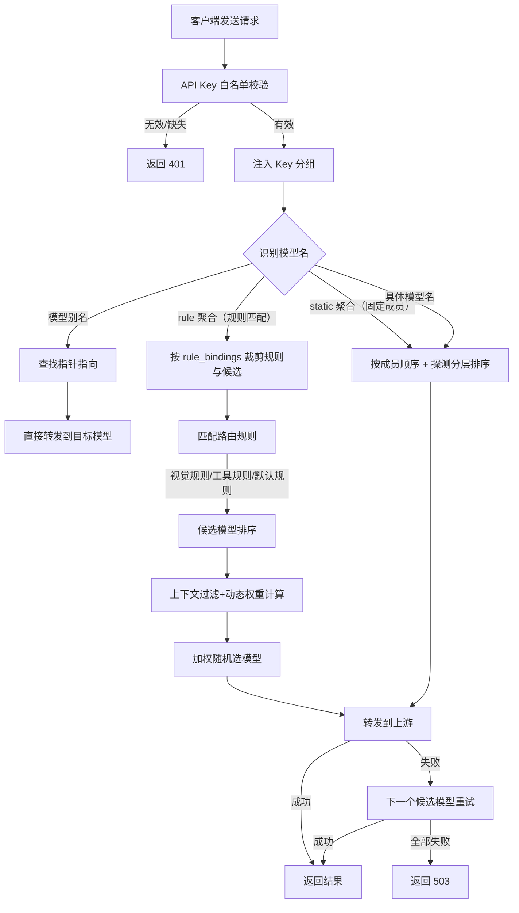
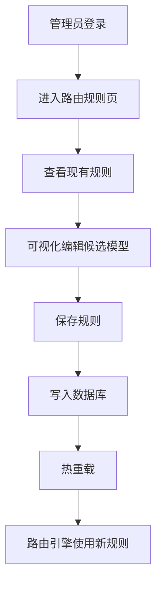
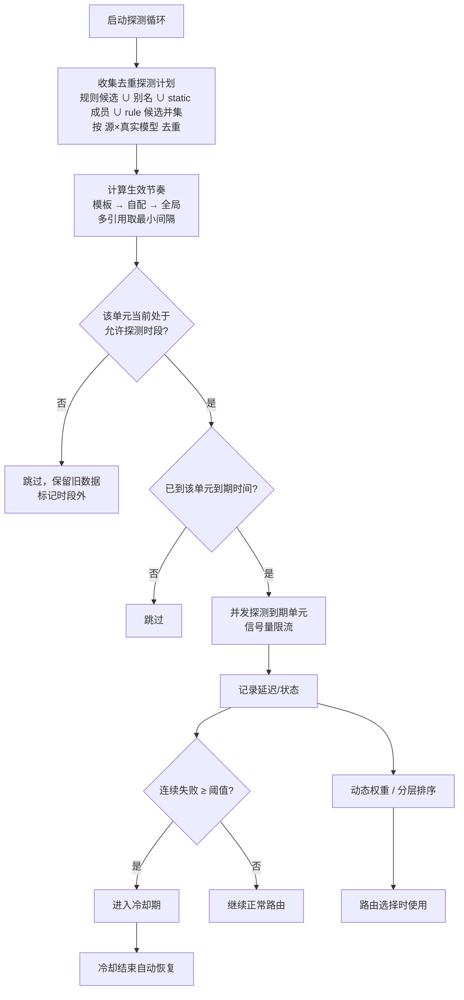
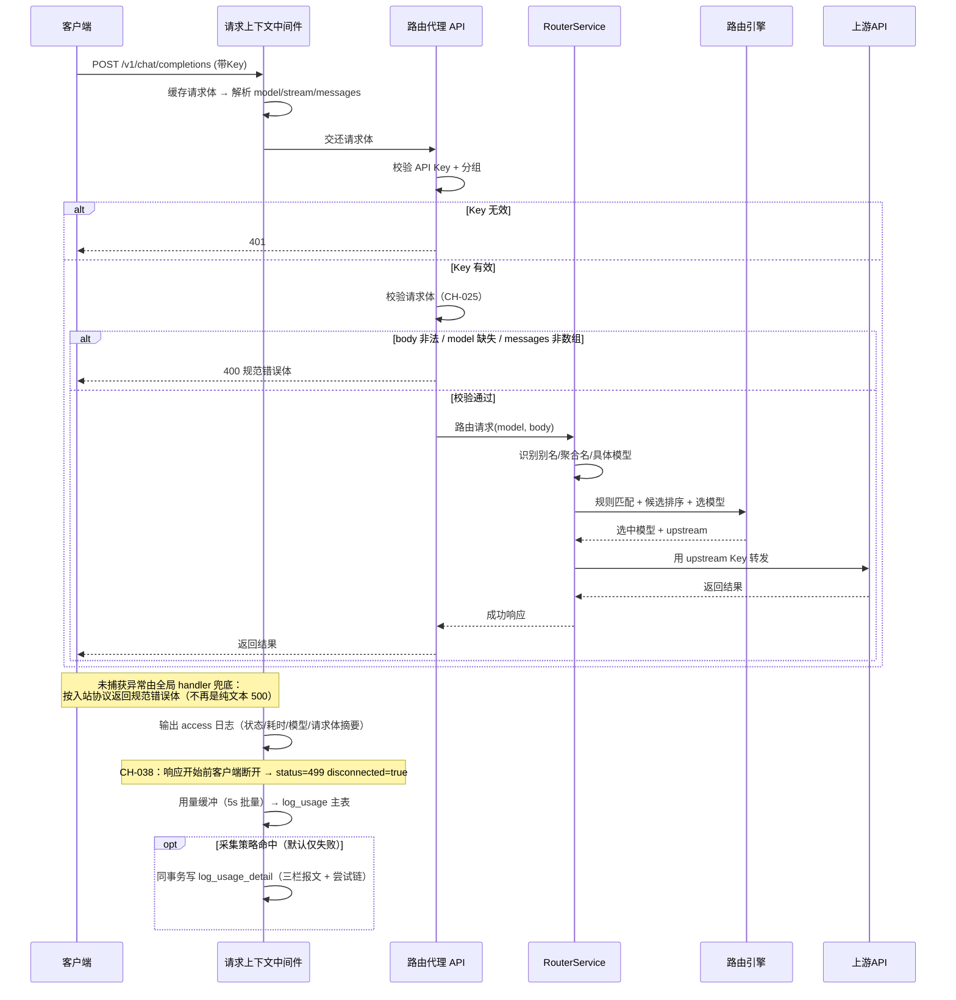
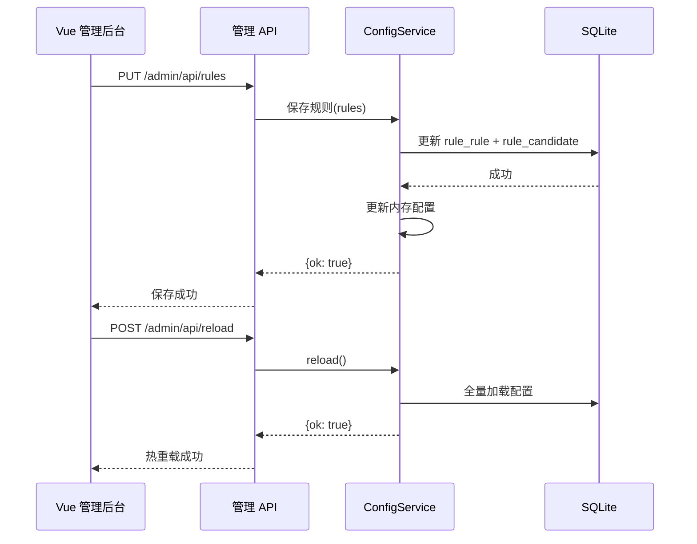
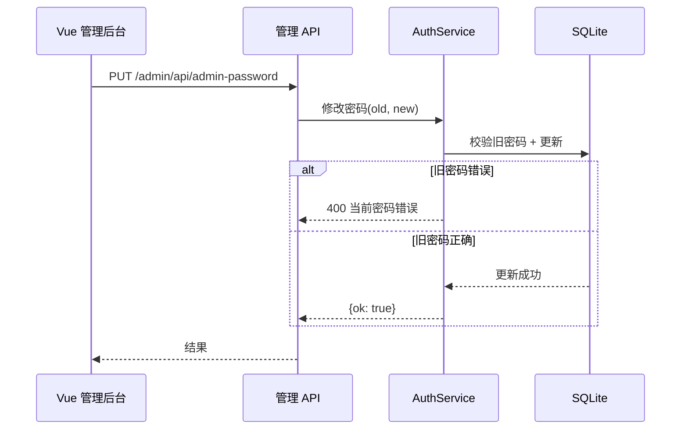

# Smart Router 架构设计文档

> 创建时间：2026-08-09
> 状态：待确认
> 关联流程：fullstack-dev-flow stage-2
> 关联需求：[docs/需求规格.md](需求规格.md)
> 版本：v5（重构）

---

## 一、技术栈选型

| 端 | 技术栈 | 版本 | 说明 |
|----|--------|------|------|
| 后端 | FastAPI | 0.110+ | 路由代理 + 管理 API |
| 后端运行 | Uvicorn | 0.27+ | ASGI 服务器 |
| 数据库 | SQLite | 3.x | 配置存储（内置 sqlite3） |
| ORM | SQLAlchemy | 2.0+ | 数据访问（可选，配置类轻量访问可用原生 sqlite3） |
| 前端 | Vue3 + Vite + TypeScript | 3.4+ / 5.x | 管理后台 |
| UI | Element Plus | 最新 | 组件库 |
| 状态管理 | Pinia | 2.x | 前端状态 |
| HTTP | axios | 1.x | 前端 HTTP 客户端 |
| 包管理 | uv（后端）/ npm（前端） | 最新 | 依赖管理 |

> **ORM 决策**：本项目配置是结构化 JSON（match 条件、groups 列表），用 SQLAlchemy 泛化 ORM 收益低。采用**原生 sqlite3 + Repository 封装**，每张表一个 Repository 类，Service 层不直接碰 SQL。若后续业务复杂化再引入 SQLAlchemy。

## 二、分层架构

### 2.1 后端分层

```
┌──────────────────────────────────────┐
│  api (路由层)                         │
│  ├─ api/v1/    客户端接口(chat/models) │  <- 接收请求、鉴权、调 Service
│  └─ api/admin/  管理接口(CRUD)        │
├──────────────────────────────────────┤
│  services (业务逻辑)                  │  <- 路由决策、配置 CRUD、探测调度
├──────────────────────────────────────┤
│  repositories (数据访问)              │  <- SQLite 每表一个 Repository
├──────────────────────────────────────┤
│  core (引擎层, 无框架依赖)            │  <- 路由引擎/探测/健康/上下文/日志
├──────────────────────────────────────┤
│  upstream (上游适配器)                │  <- OpenAI/Anthropic 格式转发
└──────────────────────────────────────┘
```

**横切层（CH-025）**：

```
┌──────────────────────────────────────┐
│  RequestContextMiddleware (ASGI 中间件)│  <- 缓存 /v1 请求体、出访问日志
├──────────────────────────────────────┤
│  @app.exception_handler(Exception)    │  <- 未捕获异常 → 按入站协议返回规范错误体
├──────────────────────────────────────┤
│  core/logging_setup (轮转文件日志)     │  <- logs/smart-router.log，10MB×5
└──────────────────────────────────────┘
```

中间件顺序（由外到内）：`RequestContextMiddleware` → `require_api_key` → 路由层。请求上下文在最外层，因此连 401 被拦截的请求也能记到 model/body 摘要。

**模块与核心实体对应**：

| 架构模块 | 对应核心实体 |
|---------|------------|
| api/v1 | 全部实体（对外入口） |
| api/admin | 全部实体（管理入口） |
| services/router_service | Rule、Candidate、Upstream、Aggregated Name、Model Pointer |
| services/config_service | 系统配置、API Key、Upstream |
| services/probe_service | 系统配置（探测参数） |
| core/router_engine | Rule、Candidate、Aggregated Name |
| core/context | 无（工具函数） |
| core/logging_setup | 无（横切：请求上下文 + 轮转文件日志，CH-025） |
| core/probe + core/health | 系统配置 |
| upstream/* | Upstream |
| repositories/* | 全部实体（数据落地） |

### 2.2 前端分层

```
┌─────────────────────────┐
│  views (页面级组件)     │  <- 路由对应页面（8 页）
├─────────────────────────┤
│  components (业务组件)   │  <- 跨页面复用
├─────────────────────────┤
│  api (接口调用封装)     │  <- 按模块分文件
├─────────────────────────┤
│  stores (Pinia 状态)    │  <- user/token 等
├─────────────────────────┤
│  utils (工具函数)       │  <- request/auth
└─────────────────────────┘
```

## 三、模块划分

| 模块 | 职责 | 涉及端 |
|------|------|--------|
| v1 路由代理 | 客户端请求入口、鉴权、路由调度 | 客户端 |
| admin 管理 | 配置 CRUD、仪表盘、热重载 | 管理后台 |
| core 引擎 | 路由决策、延迟探测、健康跟踪、上下文 | 后端内部 |
| upstream 适配 | 上游格式转换与转发 | 后端内部 |
| frontend 管理后台 | 8 个管理页面 | 管理员 |

## 四、跨端通信图

```
[客户端 (Trae/Chatbox/codex/SDK)]  ──HTTP──┐
                                            ├──> [Smart Router :10002] ──> [SQLite]
[Vue3 管理后台 :10003]              ──HTTP──┘          │
                                                       └──> [上游 NewAPI :10001 / 小米 MiMo]
```

> 前端开发期通过 Vite 代理 `/admin/api` 到 `:10002`，避免 CORS；生产期 Nginx 反向代理同源。

## 五、目录结构

```
smart-router/
├── backend/
│   ├── app/
│   │   ├── main.py              # 入口：挂载路由 + 启动探测 + 初始化
│   │   ├── core/                # 引擎层（无 FastAPI 依赖）
│   │   │   ├── config.py        # 配置门面：初始化 / 加载 / 重载 / 只读属性 / 分组（CH-026）
│   │   │   ├── config_upstream.py    # ↑ mixin：上游源查询 / Key 池 / 模型解析（CH-026）
│   │   │   ├── config_aggregation.py # ↑ mixin：聚合实体 / 规则绑定 / 模板（CH-026）
│   │   │   ├── config_probe_plan.py  # ↑ mixin：探测配置 / 单元去重 / 排班计划（CH-026）
│   │   │   ├── config_settings.py    # ↑ mixin：密钥校验 / 各类写操作（CH-026）
│   │   │   ├── logging_setup.py # 请求上下文中间件 + 轮转文件日志（CH-025）
│   │   │   ├── database.py      # SQLite 连接管理
│   │   │   ├── security.py      # JWT / 密码（密钥来自 SR_JWT_SECRET 环境变量 > sys_setting.jwt_secret > 首次启动自动生成，CH-032）
│   │   │   ├── router_engine.py # 路由决策引擎（v4 迁移）
│   │   │   ├── probe.py         # 延迟探测（v4 迁移）
│   │   │   ├── health.py        # 故障转移（v4 迁移）
│   │   │   ├── key_pool.py      # 上游源 Key 池（轮询选择 + Key 级失败冷却，CH-003）
│   │   │   └── context.py       # token 估算（v4 迁移）
│   │   ├── models/              # 数据模型定义
│   │   │   ├── api_key.py
│   │   │   ├── upstream.py
│   │   │   ├── rule.py
│   │   │   ├── pointer.py
│   │   │   ├── aggregated_name.py
│   │   │   └── setting.py
│   │   ├── repositories/        # 数据访问层
│   │   │   ├── __init__.py
│   │   │   ├── base.py          # Repository 基类
│   │   │   ├── api_key_repo.py
│   │   │   ├── upstream_repo.py
│   │   │   ├── upstream_key_repo.py  # 上游源 Key 池（CH-003）
│   │   │   ├── rule_repo.py
│   │   │   ├── pointer_repo.py
│   │   │   ├── aggregated_name_repo.py
│   │   │   └── setting_repo.py
│   │   ├── schemas/             # Pydantic 入参出参
│   │   │   ├── auth.py
│   │   │   ├── api_key.py
│   │   │   ├── upstream.py
│   │   │   ├── rule.py
│   │   │   ├── pointer.py
│   │   │   ├── aggregated_name.py
│   │   │   ├── config.py
│   │   │   └── dashboard.py
│   │   ├── services/            # 业务逻辑
│   │   │   ├── __init__.py
│   │   │   ├── auth_service.py      # 登录/JWT
│   │   │   ├── config_service.py    # 配置 CRUD + 热重载
│   │   │   ├── router_service.py    # 路由调度入口
│   │   │   ├── probe_service.py     # 探测调度
│   │   │   └── dashboard_service.py # 仪表盘聚合
│   │   ├── api/                 # 路由层
│   │   │   ├── __init__.py
│   │   │   ├── deps.py          # 依赖注入（鉴权）
│   │   │   ├── v1/              # 客户端接口
│   │   │   │   ├── __init__.py
│   │   │   │   ├── chat.py      # /v1/chat/completions + /v1/messages
│   │   │   │   ├── models.py    # /v1/models
│   │   │   │   ├── health.py    # /health /status
│   │   │   │   └── router.py    # v1 聚合
│   │   │   └── admin/           # 管理接口
│   │   │       ├── __init__.py
│   │   │       ├── auth.py      # login
│   │   │       ├── dashboard.py
│   │   │       ├── upstreams.py
│   │   │       ├── rules.py
│   │   │       ├── pointers.py
│   │   │       ├── api_keys.py
│   │   │       ├── aggregated.py
│   │   │       ├── config.py
│   │   │       └── router.py    # admin 聚合
│   │   └── upstream/            # 上游适配器（v4 迁移）
│   │       ├── __init__.py
│   │       ├── openai_adapter.py
│   │       ├── anthropic_adapter.py        # 转发 + 测试（CH-026 拆出转换）
│   │       ├── anthropic_convert.py        # 出站：OpenAI → Anthropic 请求/响应/SSE（CH-026）
│   │       ├── anthropic_convert_in.py     # 入站：Anthropic → OpenAI 逆转换（CH-026）
│   │       ├── responses_adapter.py        # 转发 + 测试（CH-026 拆出转换）
│   │       └── responses_convert.py        # OpenAI ↔ Responses 双向转换 + SSE（CH-026）
│   ├── pyproject.toml           # uv 管理
│   ├── seed.py                  # 数据库初始化（种子数据）
│   └── run.py                   # 启动入口
├── frontend/                    # Vue3 管理后台
│   ├── src/
│   │   ├── api/                 # request.js + 各模块 API
│   │   ├── components/          # 组件
│   │   │   ├── base/            # 基础组件库（全量封装，含暂未引用的，见 6.6）
│   │   │   ├── layout/          # 布局组件（BaseSidebar）
│   │   │   ├── aggregation/     # 聚合页业务组件 + 纯逻辑（binding/schedule）（CH-026）
│   │   │   ├── upstream/        # 上游源业务组件 + 表单模型（form.ts）（CH-026）
│   │   │   └── probe/           # 探测排班组件
│   │   ├── composables/         # 组合式函数（useUpstreamModels / useTemplateEditor）（CH-026）
│   │   ├── styles/              # 样式（页面级 dashboard/aggregated/upstreams + 全局 tokens/element-overrides/global-utils）（CH-026）
│   │   ├── layouts/             # 后台布局（侧边栏+顶栏）
│   │   ├── router/index.ts      # 路由 + 守卫
│   │   ├── stores/user.ts       # Pinia 用户状态
│   │   ├── utils/               # auth.js token 管理
│   │   └── views/               # 8 个页面
│   ├── vite.config.ts
│   └── package.json
├── sql/
│   ├── 01_建表.sql              # SQLite 建表
│   └── 02_init_data.sql         # 种子数据
├── docs/                        # 12 份流程文档
├── .devflow/                    # 流程管控
└── README.md
```

## 六、关键设计决策

### 6.1 前端为什么从 Streamlit 改 Vue3

**决策**: Vue3 + Element Plus 替换 Streamlit
**理由**:
- Streamlit 是"脚本渲染"模型，交互能力弱（表格编辑、弹窗、复杂表单受限）
- Element Plus 提供成熟后台组件（Table/Form/Dialog/Tabs），开发效率高
- Vue3 前后端分离，接口契约清晰，可独立部署、独立演进
- 与用户其他项目技术栈统一，维护成本低

### 6.2 配置为什么从 YAML 改 SQLite

**决策**: SQLite 替换 config.yaml
**理由**:
- YAML 并发写易冲突（管理后台多页面同时保存）
- 结构化存储天然支持 JSON 字段（match 条件、groups），无需手写 YAML 解析
- 内置 sqlite3 零依赖，单文件部署成本不变
- 路由引擎仍以"内存配置对象"为准，启动加载、修改即写库，热重载语义不变

### 6.3 后端为什么分层重组

**决策**: api → services → repositories → core/upstream
**理由**:
- v4 把路由处理、鉴权、管理 CRUD 混在 router.py + admin/api.py，随着功能增加难以维护
- 分层后：路由层只管 HTTP 语义，业务逻辑在 service，数据访问在 repository，引擎逻辑隔离在 core（纯 Python 可单测）
- 用户偏好 Spring 风格 Controller + Service 架构，与此一致

### 6.4 为什么保留内存配置缓存

**决策**: 配置以内存对象为准，数据库仅持久化
**理由**:
- 路由请求高频（每次请求读配置），直接查库有 IO 开销
- 启动时全量加载到内存 ConfigRepository，修改时写库 + 更新内存，热重载 = 重新加载
- 探测循环、健康状态本就是内存态，保持一致性

### 6.6 前端基础组件库：全量封装，允许暂未引用

**决策**：`frontend/src/components/base/` 作为**基础组件库**维护，把后台常用的基础能力一次性封装齐全，**不要求每个组件当下都有引用**。暂时没有使用场景的组件保留在库里，供后续新页面直接取用。

**理由**：
- 后台页面的 UI 骨架高度同质（页面区块、表格、弹窗、表单、空态、提示、分页），提前封装好可以避免每加一个页面就重新拼一遍 `el-*`。
- 组件被写出来但暂时没引用，成本只是一次性封装；而每次临时拼装后再回头统一，成本是反复的。
- 统一封装后，视觉与交互口径一致（间距、字号、圆角、危险色、loading 文案），改一次全站生效。

**使用约定**：
1. 新页面**优先**从 `base/` 取组件，不要直接照抄旧页面的原生 `el-*` 拼装。
2. 需要的能力 `base/` 里没有时，**先在这里补封装**，再在页面里用；不要为了一个页面写一次性模板。
3. 已有组件与 `el-*` 语义不完全对等时（如 `BaseTable` 无固定列/展开行），按页面实际需求选择，**不做机械替换**——功能退化比不统一更糟。
4. 组件新增/删除时同步更新下面的清单，避免下次忘了库里有什么。

**当前清单**（22 个，2026-10-18 CH-026）：

| 组件 | 用途 | 引用情况 |
|------|------|---------|
| `BaseSection` | 页面区块（标题 + actions 插槽 + card/plain 变体） | 已用 |
| `BaseCard` | 卡片容器 | 已用 |
| `BaseButton` | 按钮（primary/ghost/danger/icon + sm 尺寸） | 已用 |
| `BaseInput` | 输入框（含 textarea / password） | 已用 |
| `BaseBadge` | 状态徽标（多色变体） | 已用 |
| `BaseCheckTag` | 可勾选标签 | 已用 |
| `BaseModal` | 弹窗（size / layer 层级） | 已用 |
| `BaseModalFooter` | 弹窗底部「取消 + 确定 + loading」 | 已用 |
| `BaseFormGroup` | 表单字段（label / required / error / hint） | 已用 |
| `BaseEmptyState` | 空态（默认大留白 / `compact` 区块内小块占位） | 已用 |
| `BaseNotice` | 页面级说明条（info/warning/error/success + 可关闭） | 已用 |
| `BaseHint` | 说明文字（段落 / block / inline 三版式） | 已用 |
| `BasePagination` | 分页（显式 `show` 控制） | 已用 |
| `BaseIcon` | 内联 SVG 图标集 | 已用 |
| `BaseConfirm`（.ts） | 命令式确认（`confirmDanger` / `confirmAction`，返回 boolean 不抛异常） | 已用 |
| `BaseSidebar`（layout/） | 侧边栏（可折叠分组） | 已用 |
| `BaseTable` | 自研表格（列配置 / 排序 / 多选 / 密度） | **暂未引用**，待有合适场景启用 |
| `BaseSelect` | 自定义下拉（Teleport 定位，不受弹窗裁剪） | **暂未引用** |
| `BaseAlert` | 简洁提示条（`BaseNotice` 的轻量版） | **暂未引用** |
| `BaseSpinner` | 加载指示器（sm/md/lg + 文案） | **暂未引用** |
| `BaseAvatar` | 头像（首字母 + 多色） | **暂未引用** |
| `BaseCalendarPicker` | 自定义日历选择器 | **暂未引用** |

> 「暂未引用」是**有意保留**，不是待清理项。仅在确认永远不会用到时才删除，且删除需单独提一次变更。

### 6.7 前端 UI 一致性规范（2026-10-18 CH-027）

后台页面此前由多人多轮叠加，出现「同类按钮位置各异、尺寸不齐、侧边栏抖动」的问题。以下为统一口径，新页面与改动旧页面均按此执行。

**规范一：页面级主操作按钮统一右上角**

- 「新增 / 添加 / 新建」这类**页面级主操作**，一律通过 `BaseSection` 的 `#actions` 插槽挂在**标题行最右侧**。
- 禁止在标题下方另起 `<div class="toolbar">` 包裹主操作按钮。
- 同排有次要操作（如刷新）时：**刷新在左、主操作在右**（`#actions` 自带 `gap: 8px`，不要额外加 `margin-left`）。
- 例外：`系统设置`页的「+ 添加分组」是「在表格末尾追加一行」的行内语义，保留在表格下方左侧。

**规范二：区块级保存按钮统一左下角**

- 区块内的「保存 / 提交 / 热重载」类按钮，放在**该区块表单末尾、左对齐**。
- 弹窗底部不适用此规范：弹窗底部统一右对齐，并且**必须用 `BaseModalFooter`**（内置取消 + 确定 + loading 文案切换），不要手写两个 `BaseButton`。

**规范三：按钮尺寸统一**

- 区块内操作按钮、页面右上角主操作按钮：`size="sm"`（28px 高 / 12px 字号）。
- 弹窗底部按钮：由 `BaseModalFooter` 统一，不要单独指定尺寸。
- 根因提醒：`BaseButton` 默认尺寸是 32px / 13px，**漏写 `size="sm"` 就会比旁边按钮大一圈**，这是历史上按钮参差不齐的主因。

**规范四：侧边栏展开/收起不得抖动**

- `.nav-item` 用**固定高度**（`height: 36px` + `box-sizing: border-box`）而非 `padding` 撑高，保证展开态（图标 + 文字）与收起态（仅图标）高度一致。
- 纯文字节点（分组标题、导航标签）显式设定 `height` / `line-height`，收起时即便隐藏文字也不改变行高。
- 验收方式：连续收起/展开 5 次，导航项纵向 `top` 坐标差为 0。

**规范五：流式转发的两段超时**

- 流式请求（chat / messages / responses 三协议）分两个阶段计时：**等响应头**（`retry.response_timeout`）→ **等首包内容**（`retry.first_chunk_timeout`）。
- 两者独立生效：前者防上游迟迟不给响应头，后者防模型思考过久不出字。
- `response_timeout` 传 `None` 表示不限制，保持旧行为。

**规范六：列表顺序可人工调整（CH-028）**

- 聚合模型列表支持拖拽排序：卡片标题行最左的 `⠿` 手柄是**唯一拖拽热区**，卡片内其它按钮/开关不参与拖动。
- 保存的先后顺序是纯展示顺序，不参与路由决策（路由优先级仍由 `members` 数组顺序与规则优先级决定）。
- 顺序存 `sys_setting.aggregation_order`（JSON 名字数组），**不新增表字段**——因为「自动发现」的聚合没有 `agg_unified` 行，用表字段会导致这类聚合无法参与排序。
- 空数组 = 沿用默认顺序（先 static 后 rule，组内按名称）；数组里不存在的名字读取时自动忽略。

## 七、核心业务流程图

### 流程 1：客户端智能路由（核心链路）



> CH-023：`rule` 聚合（原「手写聚合名」）的候选来自路由规则匹配，仍按 priority + 动态权重排序；`static` 聚合（原「模型聚合组」）的候选来自配置的成员列表，按 stable/latency 分层排序。两者共用同一张 `agg_unified` 表，但候选来源与排序路径不同。
> CH-024：`rule` 聚合可携带 `rule_bindings`（规则子集 + 候选子集）。`get_ordered_candidates(..., aggregation=聚合名)` 先按绑定裁剪规则表，再走原有匹配与排序；无绑定 = 全跟随（等价 CH-023 行为）。

### 流程 2：管理员配置路由规则



### 流程 3：延迟探测与故障转移



> CH-021 改造：探测对象由「全局去重计划」统一决定（聚合只引用单元、不拥有），调度由「全局定时全量」改为「按单元到期」；每个单元可带独立间隔与探测时段。探测失败默认不计入 Key 冷却。
> CH-023 改造：聚合实体统一为 `agg_unified`，探测节奏可挂 `agg_probe_template` 模板（模板值优先，聚合自配被忽略）；rule 聚合的探测对象为「全部规则候选的并集」；单元记录 `groups` / `group_kinds` / `schedules` 供排班表渲染。
> CH-024 改造：rule 聚合的探测对象改为「该聚合按 `rule_bindings` 裁剪后的候选并集」，不同聚合的探测成本可区分。

## 八、关键时序图

### 时序图 1：客户端请求完整链路



> **CH-038 详情采集链路**：入站中间件把原始请求体与白名单请求头放进 `scope["state"]`，鉴权中间件再 set 到 contextvar；
> 转发层在 `copy.deepcopy` 后的 `modified` 上调用 `_capture_forward()`（= FORWARDED 栏），每个候选失败/成功都 `_note_attempt()`；
> 成功响应或上游错误体 `_capture_response()`（= RESPONSE 栏；流式只留首尾各 20 条片段）。
> `UsageBuffer.record()` 按 `usage_detail_mode` 决定是否组装 detail，落库时先插主表拿 `lastrowid`，再用同一事务插详情表。
> 报文**先脱敏再截断**，上限 `usage_detail_max_bytes`（默认 1 MB，头 3/4 + 尾 1/4）。

### 时序图 2：管理员保存配置并热重载



### 时序图 3：修改密码



## 九、范式一致性审查

参考系统：one-api/new-api（AI 中转站）+ OpenAI 网关

| 范式 | 参考系统做法 | 本项目做法 | 是否一致 |
|------|------------|-----------|---------|
| 两层 Key | 客户端密钥 + 上游密钥隔离 | 同（白名单 + 路由后换上游 Key） | ✅ 一致 |
| 上游源管理 | 多上游源接入 | 同 | ✅ 一致 |
| 统一模型名 | 路由别名入口 | 同（聚合模型名） | ✅ 一致 |
| 动态路由 | 简单规则/权重 | 增强（延迟+健康+上下文感知） | ⚠️ 偏离，理由：核心差异化能力，是项目定位 |
| 计费/分成 | 复杂计费体系 | 不做 | ✅ 有意简化 |

## 十、已知约束

- SQLite 单文件，不适合多进程并发写（本系统单进程 uvicorn，无此问题）
- 管理后台密码为明文存储于数据库（v4 亦是，与 v4 保持一致；后续可升级哈希）
- 无数据库迁移工具（Alembic），表结构变更通过增量 SQL 管理

## 十一、维护迭代架构演进（2026-08-10 攒批同步）

> 来源：CH-001~008、CH-011~014（均已上线归档）。以下为 v5 初始架构之上的演进点。

### 11.1 出站适配器层（upstream/）从一扩三

| 适配器 | 职责 | 协议路径 |
|--------|------|---------|
| openai_adapter | openai chat 直通 + `_RetryLoop` 智能重试基座 | /v1/chat/completions |
| anthropic_adapter | 转发/重试/测试；转换逻辑见 `anthropic_convert`（出站）+ `anthropic_convert_in`（入站） | /v1/messages |
| anthropic_convert / anthropic_convert_in（CH-026 拆出） | openai ↔ anthropic 双向转换（请求/响应/SSE/工具） | — |
| responses_adapter | 转发/重试/测试；转换逻辑见 `responses_convert` | /v1/responses |
| responses_convert（CH-026 拆出） | openai ↔ Responses 双向转换（input/instructions/output/SSE 事件） | — |

**模型级协议分发**（CH-011）：`core/config.get_model_protocol(upstream_id, model)` 解析"模型级 protocol → 缺省源级 format"；`services/router_service._forward` 与管理端测试按解析结果分发到对应适配器。`up_upstream.models` 列存储对象条目 `{name, protocol?}`，repo 层归一化兼容存量字符串数组。

**出站消息角色规范化**（CH-037）：`openai_adapter._normalize_messages()` 在转发前把 `role: "developer"` 改写为 `"system"`。两者在 OpenAI 规范中语义等价（developer 是 system 的新名），但部分上游/中转只认 system，遇到 developer 直接 400。DSH 等新客户端会把 developer 放在首条消息，若不改写则任何候选都必然失败。三个转发入口（`try_non_stream` / `try_stream` / `test_non_stream`）均在 `copy.deepcopy` 副本上调用，不污染调用方 body。

### 11.2 Key 池（core/key_pool.py，CH-003）

- 每上游多 Key：轮询选择（`_rr` 下标）+ Key 级失败计数冷却（连续 3 次默认冷却 120s，纯内存运行时状态）
- 适配器转发循环以"Key 数"为预算逐 Key 尝试；401/403/429/超时/连接异常记 Key 失败换下一个

### 11.3 智能重试（upstream/_RetryLoop，CH-012）

- 源级开关 `up_upstream.smart_retry`（默认关，关闭时行为与旧版逐字节一致）
- 开启时：重试预算 = Key 数 + extra_attempts；5xx 纳入可重试集合；Key 池轮换优先（立即重试），同 Key 重试前按 backoff_ms 逐级退避 + ±jitter 抖动
- 成功响应注入 `X-Served-By` / `X-Retry-Count` 调试头
- 流式沿用首字节分界线：首字节前失败可重试，吐字后中断只关流不重复

### 11.4 分组权限（CH-008 / CH-034）

- 可配置分组存 `sys_setting.groups`（不建表）；中间件鉴权时注入 `key_groups`；`allowed_groups`（`*` 通配）在各解析点过滤上游
- `GET /v1/models` 按 Key 分组过滤上游已配置模型
- **两级权限模型（CH-034）**：
  - **成员级**（真实模型）：请求直接命中上游真实模型名时，按该上游源的 `groups` 与 Key 分组取交集，无交集 → 403
  - **聚合门面级**（聚合名）：请求命中显式配置的聚合（static / rule）时，**只校验聚合自身 `agg_unified.groups`**，成员所属上游源分组完全不参与；`groups` 为空 = 所有 Key 可用
  - 自动发现的同名聚合**不算门面**（表里无行），仍走成员级校验——避免「只要有同名模型就隐式放宽分组保护」
  - 403 文案区分两层：聚合报「无权访问聚合 xxx（该聚合分组 [...]）」，真实模型报「无权访问分组 [...]（模型 xxx）」
- **聚合来源（CH-036）**：聚合只来自显式配置（`agg_unified` 行）。「同名模型自动成为聚合组」由 `sys_setting.auto_same_name_aggregate` 控制，**默认关闭**；关闭后同名模型仍跨源兜底（`collect_model_upstreams()` 独立路径），只是不再被当作聚合

### 11.5 部署形态（CH-002 系列）

- 前端构建产物（frontend_dist）由后端静态托管 + SPA fallback，管理后台与代理服务统一 10002 端口
- 增量部署脚本（test/deploy_*_incremental.py）：paramiko SFTP 上传变更文件 → 服务器侧 py_compile 预检 → systemctl 重启 → 健康验证，不触碰生产 DB（DB 变更走幂等增量 SQL）

### 11.6 可观测性与入站健壮性（CH-025）

- **请求上下文中间件**（`core/logging_setup.RequestContextMiddleware`，纯 ASGI 实现）：对 `/v1/*` 缓存请求体并解析出 `model` / `stream` / `messages` 数量，写入 `scope["state"]`；路由层与异常兜底读同一份上下文
- **访问日志**：`access` logger 每请求一行（状态码/耗时/客户端 IP/模型/流式/消息数）；4xx/5xx 附请求体摘要（截断 300 字符，`sk-xxx` 脱敏）
- **断连记录（CH-038）**：中间件包装 `receive` 捕获 `http.disconnect`，配合 `response_started` 标志；若未发出响应就开始断连，补记 `status=499 disconnected=true`（499 为我方约定语义码，真实响应从未发出）
- **文件日志**：`RotatingFileHandler` → `logs/smart-router.log`（10MB × 5），目录可用 `SMART_ROUTER_LOG_DIR` 覆盖；`GET /admin/api/logs` 只读暴露尾部
- **全局异常兜底**：`@app.exception_handler(Exception)` 按入站协议返回规范化错误体，替代 FastAPI 默认纯文本 500
- **入站请求体校验**：三个入站统一（解析失败 / 非对象 / 缺 model / messages 非数组 → 400），消除 `chat.py` 历史上的裸 500
- **容错函数类型防御**：`estimate_tokens` / `extract_text` / `has_image` 对非 list 的 `messages` 返回默认值，避免 `for None` 崩溃

### 11.7 代码治理与组件化（CH-026）

- **后端 config 门面化**：`core/config.py` 由 1019 行降为门面，按职责拆为 `config_upstream` / `config_aggregation` / `config_probe_plan` / `config_settings` 四个 mixin；`class AppConfig(UpstreamConfigMixin, AggregationConfigMixin, ProbePlanConfigMixin, SettingsConfigMixin)`，对外方法与签名零变化
- **适配器转换与转发分离**：`anthropic_convert`（出站）/ `anthropic_convert_in`（入站）/ `responses_convert` 承接纯转换，adapter 只留转发、重试与测试；原 import 路径经 re-export 保持兼容
- **前端容器瘦身**：三个超长页面拆为"容器 + 业务组件 + composable + 纯逻辑模块 + 外置样式"，容器只做数据装载与事件编排
- **基础组件补齐落地**：新增 `BaseConfirm`（命令式确认）、`BaseModalFooter`、`BaseHint`、`BaseNotice`、`BasePagination`，替换散落的 `ElMessageBox.confirm` 与重复模板
- **样式令牌化与全局样式分层**：仪表盘 SVG 图表改走 `--chart-*` 令牌，消除硬编码色值（含修正不存在的 `--accent-yellow` → `--accent-amber`）；`style.css` 756 行拆为 `styles/tokens.css`（设计令牌 + 基础重置）、`styles/element-overrides.css`（Element Plus 覆盖）、`styles/global-utils.css`（动画 / 图标尺寸 / z-index），入口仅剩 `@import`
- **基础组件全量落地**：`el-empty` / `el-alert` / 手写 `ElMessageBox.confirm` / `el-pagination` 全部替换为 `BaseEmptyState` / `BaseNotice` / `BaseConfirm` / `BasePagination`，页面上不再有同类重复实现

## 十二、变更记录

| 日期 | 变更内容 | 变更人 |
|------|---------|--------|
| 2026-08-09 | 初始创建（v5 重构设计） | AI+用户 |
| 2026-08-10 | 攒批同步（CH-001~014）：新增第十一节"维护迭代架构演进"（三适配器矩阵/模型级协议分发/Key 池/_RetryLoop/分组权限/部署形态） | AI+用户 |
| 2026-10-18 | CH-025：新增 11.6 可观测性与入站健壮性（请求上下文中间件/文件日志/异常兜底/入站校验）；2.1 补横切层与中间件顺序；时序图 1 补校验与兜底分支 | AI |
| 2026-10-18 | CH-026：新增 11.7 代码治理与组件化（config 门面 + 4 mixin、适配器转换与转发分离、前端页面拆容器/业务组件/composable）；五、目录结构与 11.1 适配器矩阵同步 | AI |
| 2026-10-19 | CH-038：时序图 1 补断连 499 与详情双写链路；11.6 补断连记录；新增「详情采集链路」说明（contextvar 贯穿、同事务双写、先脱敏再截断、默认仅失败） | AI |

