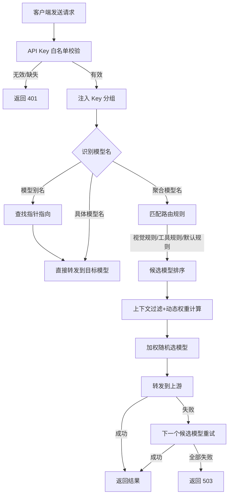
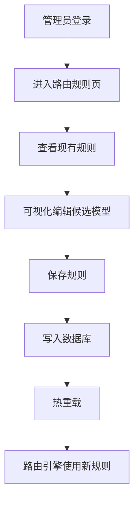
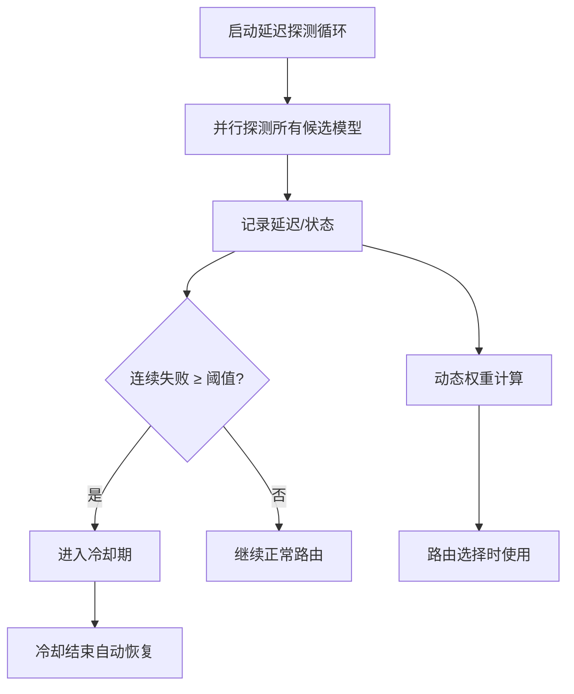
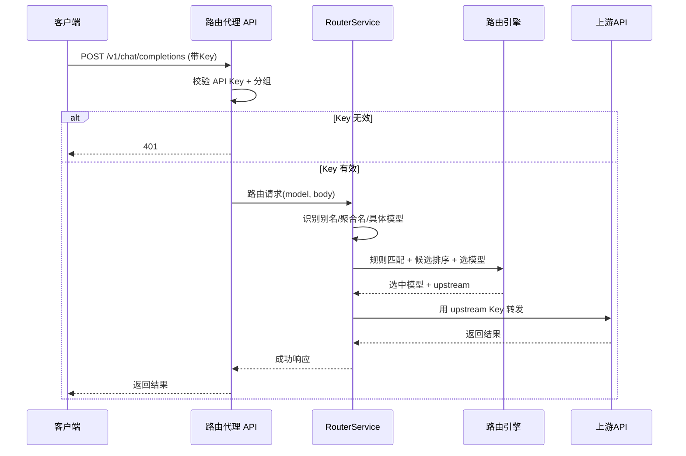
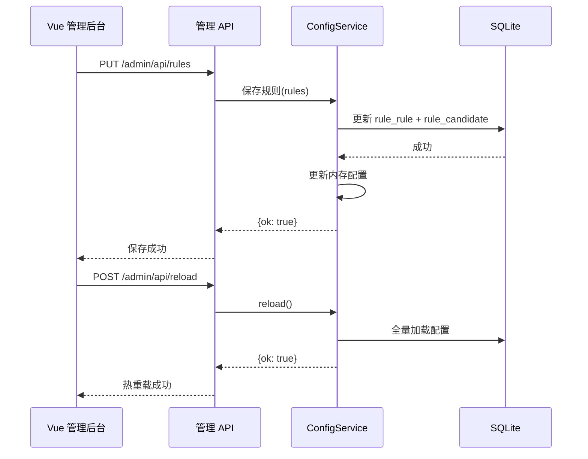
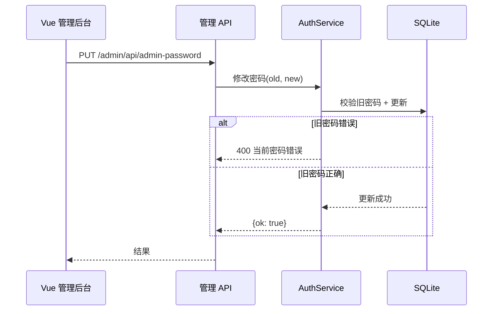

# Smart Router 架构设计文档

> 创建时间：2026-08-09
> 状态：待确认
> 关联流程：fullstack-dev-flow stage-2
> 关联需求：[docs/需求规格.md](需求规格.md)
> 版本：v5（重构）

---

## 一、技术栈选型

| 端 | 技术栈 | 版本 | 说明 |
|----|--------|------|------|
| 后端 | FastAPI | 0.110+ | 路由代理 + 管理 API |
| 后端运行 | Uvicorn | 0.27+ | ASGI 服务器 |
| 数据库 | SQLite | 3.x | 配置存储（内置 sqlite3） |
| ORM | SQLAlchemy | 2.0+ | 数据访问（可选，配置类轻量访问可用原生 sqlite3） |
| 前端 | Vue3 + Vite + TypeScript | 3.4+ / 5.x | 管理后台 |
| UI | Element Plus | 最新 | 组件库 |
| 状态管理 | Pinia | 2.x | 前端状态 |
| HTTP | axios | 1.x | 前端 HTTP 客户端 |
| 包管理 | uv（后端）/ npm（前端） | 最新 | 依赖管理 |

> **ORM 决策**：本项目配置是结构化 JSON（match 条件、groups 列表），用 SQLAlchemy 泛化 ORM 收益低。采用**原生 sqlite3 + Repository 封装**，每张表一个 Repository 类，Service 层不直接碰 SQL。若后续业务复杂化再引入 SQLAlchemy。

## 二、分层架构

### 2.1 后端分层

```
┌──────────────────────────────────────┐
│  api (路由层)                         │
│  ├─ api/v1/    客户端接口(chat/models) │  <- 接收请求、鉴权、调 Service
│  └─ api/admin/  管理接口(CRUD)        │
├──────────────────────────────────────┤
│  services (业务逻辑)                  │  <- 路由决策、配置 CRUD、探测调度
├──────────────────────────────────────┤
│  repositories (数据访问)              │  <- SQLite 每表一个 Repository
├──────────────────────────────────────┤
│  core (引擎层, 无框架依赖)            │  <- 路由引擎/探测/健康/上下文
├──────────────────────────────────────┤
│  upstream (上游适配器)                │  <- OpenAI/Anthropic 格式转发
└──────────────────────────────────────┘
```

**模块与核心实体对应**：

| 架构模块 | 对应核心实体 |
|---------|------------|
| api/v1 | 全部实体（对外入口） |
| api/admin | 全部实体（管理入口） |
| services/router_service | Rule、Candidate、Upstream、Aggregated Name、Model Pointer |
| services/config_service | 系统配置、API Key、Upstream |
| services/probe_service | 系统配置（探测参数） |
| core/router_engine | Rule、Candidate、Aggregated Name |
| core/context | 无（工具函数） |
| core/probe + core/health | 系统配置 |
| upstream/* | Upstream |
| repositories/* | 全部实体（数据落地） |

### 2.2 前端分层

```
┌─────────────────────────┐
│  views (页面级组件)     │  <- 路由对应页面（8 页）
├─────────────────────────┤
│  components (业务组件)   │  <- 跨页面复用
├─────────────────────────┤
│  api (接口调用封装)     │  <- 按模块分文件
├─────────────────────────┤
│  stores (Pinia 状态)    │  <- user/token 等
├─────────────────────────┤
│  utils (工具函数)       │  <- request/auth
└─────────────────────────┘
```

## 三、模块划分

| 模块 | 职责 | 涉及端 |
|------|------|--------|
| v1 路由代理 | 客户端请求入口、鉴权、路由调度 | 客户端 |
| admin 管理 | 配置 CRUD、仪表盘、热重载 | 管理后台 |
| core 引擎 | 路由决策、延迟探测、健康跟踪、上下文 | 后端内部 |
| upstream 适配 | 上游格式转换与转发 | 后端内部 |
| frontend 管理后台 | 8 个管理页面 | 管理员 |

## 四、跨端通信图

```
[客户端 (Trae/Chatbox/codex/SDK)]  ──HTTP──┐
                                            ├──> [Smart Router :10002] ──> [SQLite]
[Vue3 管理后台 :10003]              ──HTTP──┘          │
                                                       └──> [上游 NewAPI :10001 / 小米 MiMo]
```

> 前端开发期通过 Vite 代理 `/admin/api` 到 `:10002`，避免 CORS；生产期 Nginx 反向代理同源。

## 五、目录结构

```
smart-router/
├── backend/
│   ├── app/
│   │   ├── main.py              # 入口：挂载路由 + 启动探测 + 初始化
│   │   ├── core/                # 引擎层（无 FastAPI 依赖）
│   │   │   ├── config.py        # 配置仓库（内存缓存 + 数据库读写 + 热重载）
│   │   │   ├── database.py      # SQLite 连接管理
│   │   │   ├── security.py      # JWT / 密码
│   │   │   ├── router_engine.py # 路由决策引擎（v4 迁移）
│   │   │   ├── probe.py         # 延迟探测（v4 迁移）
│   │   │   ├── health.py        # 故障转移（v4 迁移）
│   │   │   ├── key_pool.py      # 上游源 Key 池（轮询选择 + Key 级失败冷却，CH-003）
│   │   │   └── context.py       # token 估算（v4 迁移）
│   │   ├── models/              # 数据模型定义
│   │   │   ├── api_key.py
│   │   │   ├── upstream.py
│   │   │   ├── rule.py
│   │   │   ├── pointer.py
│   │   │   ├── aggregated_name.py
│   │   │   └── setting.py
│   │   ├── repositories/        # 数据访问层
│   │   │   ├── __init__.py
│   │   │   ├── base.py          # Repository 基类
│   │   │   ├── api_key_repo.py
│   │   │   ├── upstream_repo.py
│   │   │   ├── upstream_key_repo.py  # 上游源 Key 池（CH-003）
│   │   │   ├── rule_repo.py
│   │   │   ├── pointer_repo.py
│   │   │   ├── aggregated_name_repo.py
│   │   │   └── setting_repo.py
│   │   ├── schemas/             # Pydantic 入参出参
│   │   │   ├── auth.py
│   │   │   ├── api_key.py
│   │   │   ├── upstream.py
│   │   │   ├── rule.py
│   │   │   ├── pointer.py
│   │   │   ├── aggregated_name.py
│   │   │   ├── config.py
│   │   │   └── dashboard.py
│   │   ├── services/            # 业务逻辑
│   │   │   ├── __init__.py
│   │   │   ├── auth_service.py      # 登录/JWT
│   │   │   ├── config_service.py    # 配置 CRUD + 热重载
│   │   │   ├── router_service.py    # 路由调度入口
│   │   │   ├── probe_service.py     # 探测调度
│   │   │   └── dashboard_service.py # 仪表盘聚合
│   │   ├── api/                 # 路由层
│   │   │   ├── __init__.py
│   │   │   ├── deps.py          # 依赖注入（鉴权）
│   │   │   ├── v1/              # 客户端接口
│   │   │   │   ├── __init__.py
│   │   │   │   ├── chat.py      # /v1/chat/completions + /v1/messages
│   │   │   │   ├── models.py    # /v1/models
│   │   │   │   ├── health.py    # /health /status
│   │   │   │   └── router.py    # v1 聚合
│   │   │   └── admin/           # 管理接口
│   │   │       ├── __init__.py
│   │   │       ├── auth.py      # login
│   │   │       ├── dashboard.py
│   │   │       ├── upstreams.py
│   │   │       ├── rules.py
│   │   │       ├── pointers.py
│   │   │       ├── api_keys.py
│   │   │       ├── aggregated.py
│   │   │       ├── config.py
│   │   │       └── router.py    # admin 聚合
│   │   └── upstream/            # 上游适配器（v4 迁移）
│   │       ├── __init__.py
│   │       ├── openai_adapter.py
│   │       └── anthropic_adapter.py
│   ├── pyproject.toml           # uv 管理
│   ├── seed.py                  # 数据库初始化（种子数据）
│   └── run.py                   # 启动入口
├── frontend/                    # Vue3 管理后台
│   ├── src/
│   │   ├── api/                 # request.js + 各模块 API
│   │   ├── components/          # 通用组件
│   │   ├── layouts/             # 后台布局（侧边栏+顶栏）
│   │   ├── router/index.ts      # 路由 + 守卫
│   │   ├── stores/user.ts       # Pinia 用户状态
│   │   ├── utils/               # auth.js token 管理
│   │   └── views/               # 8 个页面
│   ├── vite.config.ts
│   └── package.json
├── sql/
│   ├── 01_建表.sql              # SQLite 建表
│   └── 02_init_data.sql         # 种子数据
├── docs/                        # 12 份流程文档
├── .devflow/                    # 流程管控
└── README.md
```

## 六、关键设计决策

### 6.1 前端为什么从 Streamlit 改 Vue3

**决策**: Vue3 + Element Plus 替换 Streamlit
**理由**:
- Streamlit 是"脚本渲染"模型，交互能力弱（表格编辑、弹窗、复杂表单受限）
- Element Plus 提供成熟后台组件（Table/Form/Dialog/Tabs），开发效率高
- Vue3 前后端分离，接口契约清晰，可独立部署、独立演进
- 与用户其他项目技术栈统一，维护成本低

### 6.2 配置为什么从 YAML 改 SQLite

**决策**: SQLite 替换 config.yaml
**理由**:
- YAML 并发写易冲突（管理后台多页面同时保存）
- 结构化存储天然支持 JSON 字段（match 条件、groups），无需手写 YAML 解析
- 内置 sqlite3 零依赖，单文件部署成本不变
- 路由引擎仍以"内存配置对象"为准，启动加载、修改即写库，热重载语义不变

### 6.3 后端为什么分层重组

**决策**: api → services → repositories → core/upstream
**理由**:
- v4 把路由处理、鉴权、管理 CRUD 混在 router.py + admin/api.py，随着功能增加难以维护
- 分层后：路由层只管 HTTP 语义，业务逻辑在 service，数据访问在 repository，引擎逻辑隔离在 core（纯 Python 可单测）
- 用户偏好 Spring 风格 Controller + Service 架构，与此一致

### 6.4 为什么保留内存配置缓存

**决策**: 配置以内存对象为准，数据库仅持久化
**理由**:
- 路由请求高频（每次请求读配置），直接查库有 IO 开销
- 启动时全量加载到内存 ConfigRepository，修改时写库 + 更新内存，热重载 = 重新加载
- 探测循环、健康状态本就是内存态，保持一致性

## 七、核心业务流程图

### 流程 1：客户端智能路由（核心链路）



### 流程 2：管理员配置路由规则



### 流程 3：延迟探测与故障转移



## 八、关键时序图

### 时序图 1：客户端请求完整链路



### 时序图 2：管理员保存配置并热重载



### 时序图 3：修改密码



## 九、范式一致性审查

参考系统：one-api/new-api（AI 中转站）+ OpenAI 网关

| 范式 | 参考系统做法 | 本项目做法 | 是否一致 |
|------|------------|-----------|---------|
| 两层 Key | 客户端密钥 + 上游密钥隔离 | 同（白名单 + 路由后换上游 Key） | ✅ 一致 |
| 上游源管理 | 多上游源接入 | 同 | ✅ 一致 |
| 统一模型名 | 路由别名入口 | 同（聚合模型名） | ✅ 一致 |
| 动态路由 | 简单规则/权重 | 增强（延迟+健康+上下文感知） | ⚠️ 偏离，理由：核心差异化能力，是项目定位 |
| 计费/分成 | 复杂计费体系 | 不做 | ✅ 有意简化 |

## 十、已知约束

- SQLite 单文件，不适合多进程并发写（本系统单进程 uvicorn，无此问题）
- 管理后台密码为明文存储于数据库（v4 亦是，与 v4 保持一致；后续可升级哈希）
- 无数据库迁移工具（Alembic），表结构变更通过增量 SQL 管理

## 十一、维护迭代架构演进（2026-08-10 攒批同步）

> 来源：CH-001~008、CH-011~014（均已上线归档）。以下为 v5 初始架构之上的演进点。

### 11.1 出站适配器层（upstream/）从一扩三

| 适配器 | 职责 | 协议路径 |
|--------|------|---------|
| openai_adapter | openai chat 直通 + `_RetryLoop` 智能重试基座 | /v1/chat/completions |
| anthropic_adapter | openai ↔ anthropic 双向转换（请求/响应/SSE/工具） | /v1/messages |
| responses_adapter（CH-014 新增） | openai ↔ Responses 双向转换（input/instructions/output/SSE 事件） | /v1/responses |

**模型级协议分发**（CH-011）：`core/config.get_model_protocol(upstream_id, model)` 解析"模型级 protocol → 缺省源级 format"；`services/router_service._forward` 与管理端测试按解析结果分发到对应适配器。`up_upstream.models` 列存储对象条目 `{name, protocol?}`，repo 层归一化兼容存量字符串数组。

### 11.2 Key 池（core/key_pool.py，CH-003）

- 每上游多 Key：轮询选择（`_rr` 下标）+ Key 级失败计数冷却（连续 3 次默认冷却 120s，纯内存运行时状态）
- 适配器转发循环以"Key 数"为预算逐 Key 尝试；401/403/429/超时/连接异常记 Key 失败换下一个

### 11.3 智能重试（upstream/_RetryLoop，CH-012）

- 源级开关 `up_upstream.smart_retry`（默认关，关闭时行为与旧版逐字节一致）
- 开启时：重试预算 = Key 数 + extra_attempts；5xx 纳入可重试集合；Key 池轮换优先（立即重试），同 Key 重试前按 backoff_ms 逐级退避 + ±jitter 抖动
- 成功响应注入 `X-Served-By` / `X-Retry-Count` 调试头
- 流式沿用首字节分界线：首字节前失败可重试，吐字后中断只关流不重复

### 11.4 分组权限（CH-008）

- 可配置分组存 `sys_setting.groups`（不建表）；中间件鉴权时注入 `key_groups`；`allowed_groups`（`*` 通配）在各解析点过滤上游
- `GET /v1/models` 按 Key 分组过滤上游已配置模型

### 11.5 部署形态（CH-002 系列）

- 前端构建产物（frontend_dist）由后端静态托管 + SPA fallback，管理后台与代理服务统一 10002 端口
- 增量部署脚本（test/deploy_*_incremental.py）：paramiko SFTP 上传变更文件 → 服务器侧 py_compile 预检 → systemctl 重启 → 健康验证，不触碰生产 DB（DB 变更走幂等增量 SQL）

## 十二、变更记录

| 日期 | 变更内容 | 变更人 |
|------|---------|--------|
| 2026-08-09 | 初始创建（v5 重构设计） | AI+用户 |
| 2026-08-10 | 攒批同步（CH-001~014）：新增第十一节"维护迭代架构演进"（三适配器矩阵/模型级协议分发/Key 池/_RetryLoop/分组权限/部署形态） | AI+用户 |
