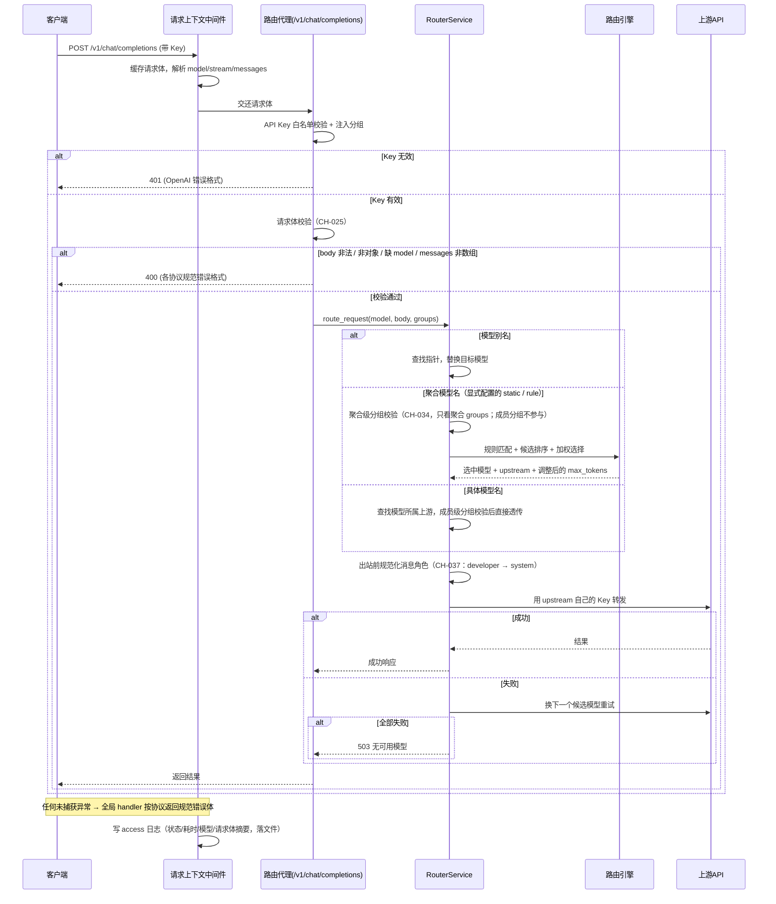
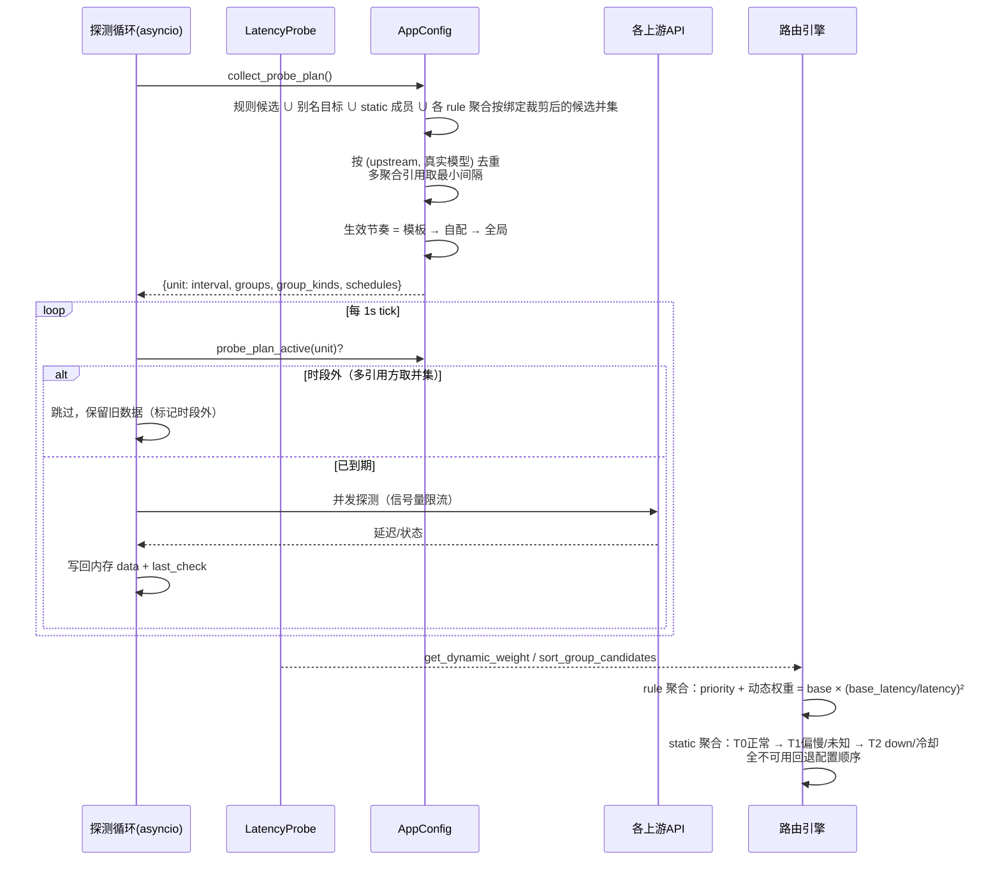
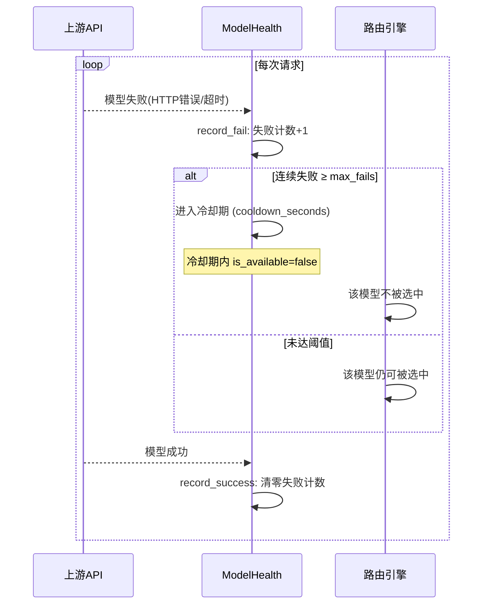
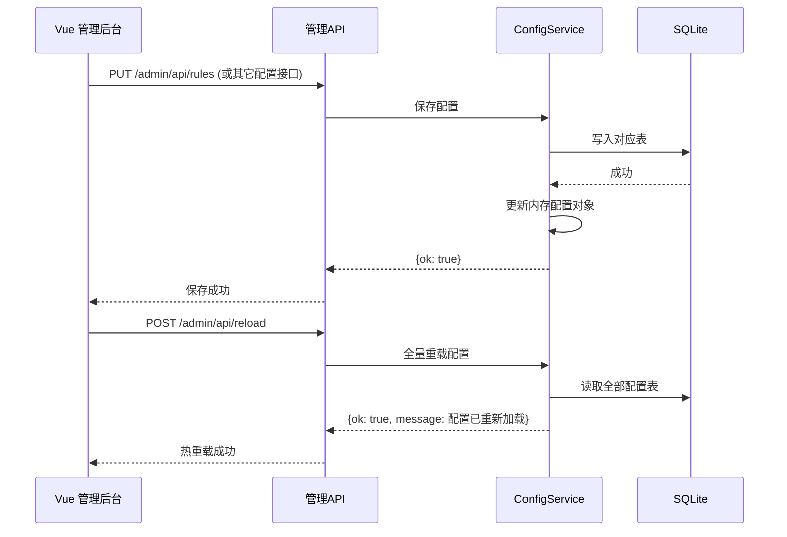
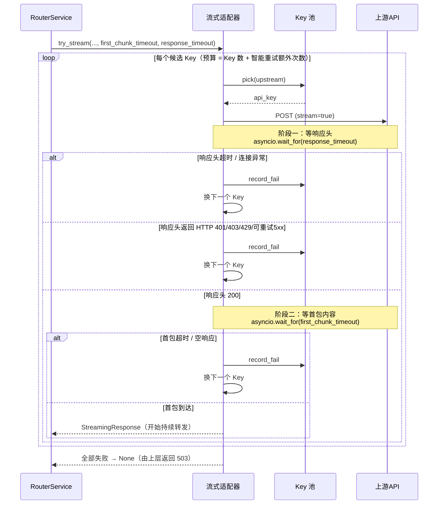

# Smart Router 系统核心流程与对外能力清单

> 本文档浓缩系统的业务全貌：核心流程图 + 对外能力清单 + 外部依赖 + 数据表速览。
> 设计阶段产出初版；每轮重大变更后同步更新，作为"文档 vs 代码"对照基线。
>
> 关联流程：fullstack-dev-flow stage-2（产出）→ stage-5/6（对照验收）
> 关联需求：[docs/需求规格.md](需求规格.md)
> 关联架构：[docs/架构设计.md](架构设计.md)

---

## 一、设计原则

| 维度 | 设计选择 | 理由 |
|------|---------|------|
| 配置状态源 | SQLite 数据库（内存缓存 + 热重载） | 结构化存储、并发安全，启动全量加载到内存保证路由性能 |
| 路由决策归属 | 后端引擎计算（core/router_engine） | 决策逻辑纯 Python 可单测，动态权重结合实时延迟 |
| 鉴权模型 | 两层 Key（客户端白名单 + 上游自有密钥） | 客户端密钥不透传上游，隔离安全 |
| 故障兜底 | 引擎内自动（候选重试 + 冷却 + 降级） | 无需外部编排，请求链路自愈 |
| 延迟感知 | 后台定时探测（asyncio 循环） | 实时延迟驱动动态权重，慢模型自动排除 |

---

## 二、核心流程图

### 流程 1：客户端智能路由（核心链路）

### 流程 2：延迟探测与动态权重

> CH-021：探测单元由全局去重计划决定（聚合只引用不拥有）；调度改为按单元到期；支持独立间隔与探测时段；探测失败默认不计入 Key 冷却。
> CH-023：聚合统一为 `agg_unified`（`kind` = static / rule）；探测节奏可按**模板**定义（模板值优先，不可被聚合覆盖）；rule 聚合的探测对象是**全部规则候选的并集**；单元上记录 `groups` / `group_kinds` / `schedules`，排班表据此渲染。
> CH-024：rule 聚合的探测对象改为**该聚合按 `rule_bindings` 裁剪后的候选并集**（无绑定 = 全部规则并集），故不同 rule 聚合的单元数与探测成本可区分；保存规则后自动清理失效绑定（`prune_rule_bindings`）。
> **排序语义未变**：rule 聚合仍走 `get_ordered_candidates`（priority + 动态权重），静态聚合走 `sort_group_candidates`（stable/latency 分层），两者互不影响。

### 流程 3：故障转移（冷却）

### 流程 4：管理员配置热重载

### 流程 5：流式转发的两段超时（CH-027）

流式请求（`/v1/chat/completions`、`/v1/messages`、`/v1/responses`）在 `try_stream*` 内部按**两个独立阶段**计时，任一阶段超时都视为该 Key 失败，换下一个 Key 重试。

> **两个超时的分工**：`response_timeout`（`retry.response_timeout`，默认 20s）只管「上游多久给出响应头」；`first_chunk_timeout`（`retry.first_chunk_timeout`，默认 8s）只管「响应头已返回后多久出第一个数据块」。模型思考很久属于第二阶段，不受 `response_timeout` 影响。
> **兼容旧行为**：`response_timeout` 传 `None` 时不包 `wait_for`，仍由 `httpx` 全局超时兜底。
> **与非流式对齐**：`try_non_stream` 一直有该保护，本次补齐流式三适配器（`openai_adapter` / `anthropic_adapter` / `responses_adapter`）的同类缺口。

---

## 三、对外能力清单

### 域 1：对话与推理（客户端入口）

| 工具/接口 | 用途 | 标签 | 对应数据库表 |
|---------|------|------|-------------|
| POST /v1/chat/completions | OpenAI 兼容聊天补全（聚合路由/别名/透传；出站按模型级协议分发 openai/anthropic/responses） | W | rule_rule, rule_candidate, pt_pointer, up_upstream |
| POST /v1/messages | Anthropic 入站（CH-009，x-api-key 兼容，自动双向转换） | W | 同上 |
| POST /v1/responses | Responses 入站（CH-010，Codex 可用，自动双向转换） | W | 同上 |
| GET /v1/models | 模型列表（真实模型按上游分组过滤；聚合条目按聚合自身 groups 过滤，CH-034） | R | up_upstream, agg_unified(groups), pt_pointer, api_api_key, sys_setting(groups) |

### 域 2：状态与健康（公开）

| 工具/接口 | 用途 | 标签 | 对应数据库表 |
|---------|------|------|-------------|
| GET /health | 健康检查 | R | - |
| GET /status | 延迟面板 + 路由状态 | R | -（内存状态） |

### 域 3：管理后台（管理员）

| 工具/接口 | 用途 | 标签 | 对应数据库表 |
|---------|------|------|-------------|
| POST /admin/api/login | 管理员登录 | W | sys_setting(admin) |
| GET /admin/api/dashboard | 仪表盘聚合数据（CH-022：用量/趋势/上游占比/聚合组/待关注/探测摘要） | R | log_usage, up_upstream, agg_model_group, agg_probe_config, sys_setting |
| GET/POST /admin/api/upstreams, PUT/DELETE /admin/api/upstreams/{id} | 上游源管理（含启用开关、智能重试开关、Key 池） | R/W/D | up_upstream, up_upstream_key |
| PUT /admin/api/upstreams/{id}/models, DELETE .../models?model= | 上游已配置模型列表（对象条目 {name, protocol?}） | W/D | up_upstream(models) |
| GET /admin/api/upstreams/{id}/models | 代理拉取上游远端模型列表 | R | -（代理转发） |
| POST /admin/api/upstreams/{id}/test | 单模型在线测试（按模型级协议分发） | W | - |
| GET/PUT /admin/api/groups | 分组管理（被引用不可删） | R/W | sys_setting(groups) |
| GET/PUT /admin/api/config/smart-retry | 智能重试全局参数 | R/W | sys_setting |
| GET/PUT /admin/api/rules | 路由规则管理 | R/W | rule_rule, rule_candidate |
| GET/POST/PUT/DELETE /admin/api/model-pointers* | 模型别名管理 | R/W/D | pt_pointer |
| GET/POST/PUT/DELETE /admin/api/api-keys* | 客户端密钥管理 | R/W/D | api_api_key |
| GET/PUT /admin/api/aggregated-names | 聚合模型名管理（CH-023 兼容入口，内部读写 `agg_unified` kind=rule） | R/W | agg_unified |
| GET/PUT/DELETE /admin/api/model-groups | 模型聚合组（同名/异名，成员含真实模型名；CH-023 兼容入口） | R/W/D | agg_unified |
| GET/PUT/DELETE /admin/api/aggregations | 统一聚合管理（static 固定成员 / rule 规则匹配，含探测与排序配置；rule 可带 `rule_bindings` 规则/候选子集绑定，CH-024） | R/W/D | agg_unified |
| GET /admin/api/aggregations/rule-units?name= | rule 聚合的探测对象（传 name 返回该聚合按绑定裁剪后的候选并集，不传为全部规则并集） | R | rule_rule, rule_candidate, agg_unified |
| GET/POST/PUT/DELETE /admin/api/probe-templates* | 探测模板管理（一套可复用探测节奏，模板值优先不可覆盖） | R/W/D | agg_probe_template |
| GET /admin/api/model-groups/probe-configs | 各聚合探测配置与生效值 | R | agg_unified, agg_probe_config |
| PUT/DELETE /admin/api/model-groups/probe | 保存/重置单个聚合的探测策略（含时段，兼容入口） | W/D | agg_unified, agg_probe_config |
| GET /admin/api/probe-plan（兼容 .../model-groups/probe-plan） | 全局去重探测计划 + 成本汇总 + 引用聚合类型 | R | agg_unified, agg_probe_template, up_upstream |
| GET /admin/api/usage/summary\|by-model\|by-key\|by-unit\|logs | 用量统计（含按「源×真实模型」号池核算） | R | log_usage |
| GET/PUT /admin/api/config/probe | 延迟探测配置（含并发数/Key 冷却开关/全局时段） | R/W | sys_setting |
| GET/PUT /admin/api/config/retry | 重试配置 | R/W | sys_setting |
| GET/PUT /admin/api/config/failover | 故障转移配置 | R/W | sys_setting |
| PUT /admin/api/admin-password | 修改管理员密码 | W | sys_setting(admin) |
| POST /admin/api/reload | 热重载配置 | D | 全表 |
| GET /admin/api/logs?lines=&keyword= | 运行日志尾部读取（CH-025，含请求上下文：model/stream/body 摘要） | R | -（日志文件） |
| GET /admin/api/logs/info | 日志文件路径与大小（CH-025） | R | -（日志文件） |

---

## 四、外部依赖与兜底链

### 外部依赖

| 依赖 | 用途 | 不可用影响 | 兜底方案 |
|------|------|-----------|---------|
| 上游模型提供商（NewAPI/小米） | 模型推理 | 该上游的模型全部失败 | 故障转移切换到其他候选模型 |
| 无外部数据库依赖 | SQLite 本地文件 | - | - |
| 无消息队列/调度器 | 探测用 asyncio 循环 | - | - |

### 兜底链

| 场景 | 降级链（从左到右） | 说明 |
|------|-------------------|------|
| 某候选模型失败 | 失败模型 → 同规则下一候选 → 降级候选（P3）→ 503 | get_ordered_candidates 排序后按序重试 |
| 所有候选权重为 0 | 跳过加权选择 → 返回原始候选列表 → 交给上游判定 | 避免直接 503，让真实请求裁决 |
| 全部模型不可用 | 所有候选失败 → 503 "所有模型均不可用" | 返回尝试过的模型列表 |
| 探测超时 | 该模型延迟记为超时 → down 状态 → 动态权重归 0 | 冷却恢复后自动回归 |

---

## 五、数据库表速览

| 表名 | 用途 | 主要字段 |
|------|------|---------|
| api_api_key | 客户端访问密钥 | name, key_value, groups, enabled |
| up_upstream | 上游模型提供商 | upstream_id, base_url, api_key, format, group_name（冗余）, groups(多分组 JSON), enabled, probe_enabled, models(JSON 对象条目), smart_retry |
| up_upstream_key | 上游 Key 池（CH-003） | upstream_id, api_key, enabled |
| rule_rule | 路由规则 | name, match_json, sort_order |
| rule_candidate | 规则候选模型 | rule_id, model, weight, priority, max_context, max_output |
| pt_pointer | 模型别名指针 | name, target_model, upstream_id |
| agg_aggregated_name | 聚合模型名（CH-023 起为兼容兜底，读取已切 agg_unified） | name |
| agg_model_group | 模型聚合组（CH-019/020；CH-023 起为兼容兜底） | model(聚合名), upstreams(JSON: upstream/model/weight), enabled |
| agg_probe_config | 聚合组探测策略（CH-021；CH-023 起为兼容兜底） | model, enabled, interval_seconds, slow_threshold_seconds, sort_mode, schedule(JSON 时段) |
| agg_unified | **统一聚合实体（CH-023）** | name, kind(static/rule), members(JSON), rule_bindings(JSON 规则/候选子集绑定，CH-024), enabled, probe_enabled, template_id, sort_mode, interval_seconds, slow_threshold_seconds, schedule, remark |
| agg_probe_template | **探测模板（CH-023）** | id, name, interval_seconds, slow_threshold_seconds, sort_mode, schedule(JSON 时段), remark |
| log_usage | 请求用量明细（CH-019/021） | ts, api_key_id/name, upstream_id/name, model(请求名), upstream_model(真实名), status, tokens, duration_ms |
| sys_setting | 系统参数（含 groups 可配置分组、smart_retry 智能重试参数、latency_probe 探测参数） | key, value(JSON) |

---

## 六、CLI 与对外能力对齐情况

本系统无 CLI，全部能力通过 REST API 暴露（见第三部分对外能力清单），无能力缺口。

---

## 变更记录

| 日期 | 变更内容 | 变更人 |
|------|---------|--------|
| 2026-08-09 | 初始创建（v5 重构） | AI+用户 |
| 2026-08-10 | 攒批同步（CH-001~014）：/v1/messages、/v1/responses 标注为入站规划（原误标已实现）；新增模型管理/分组/智能重试/拉取代理等管理接口；表速览补 up_upstream_key 与 up_upstream 新列 | AI+用户 |
| 2026-08-11 | CH-009/010 上线：/v1/messages、/v1/responses 入站端点转为已实现，3×3 协议矩阵收齐 | AI+用户 |
| 2026-10-17 | CH-023：聚合实体统一（`agg_unified` static/rule）+ 探测模板（`agg_probe_template`）+ rule 聚合纳入探测计划（候选并集）+ 探测排班表；旧聚合三表降级为兼容兜底；新增 5 组管理端点 | AI |
| 2026-10-18 | CH-025：核心流程图 1 补「请求上下文中间件 → 入站校验 → 全局异常兜底」三段；能力清单补 `/admin/api/logs` 与 `/logs/info`；新增日志可观测性说明 | AI |
| 2026-10-18 | CH-034：核心流程图 1 区分「聚合门面级分组校验」与「真实模型成员级分组校验」；`/v1/models` 能力清单改为聚合条目按聚合自身 groups 过滤（数据表引用补 agg_unified.groups） | AI |
